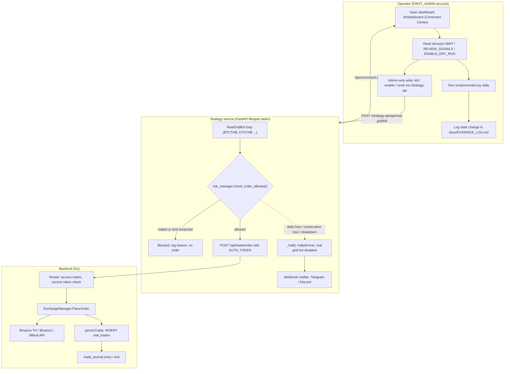
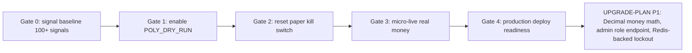

# 01 — Business Process (As-Is / To-Be)

ระบบนี้คือ BookFinance (repo `finance-booktrading`) — trading command center ของเจ้าของคนเดียว (single operator)
ที่ default เป็น observe-only และให้ bot ทำงานภายใต้ risk manager / kill switch
ภาพรวม business swimlane ฉบับกลางอยู่ที่ central flow pack (ดู "Reused" ด้านล่าง) — ไฟล์นี้วาดใหม่จาก code ปัจจุบัน (`origin/main` 425b989, 2026-11-03)
เพราะบางจุดใน pack (pinned 8de42ee, 2026-08-19) ไม่ตรงกับ code แล้ว

## As-Is (จาก code วันนี้)

กระบวนการจริงมี 3 lane: operator (คนเดียว, admin), strategy service (Python bots) และ backend (Go, ถือ exchange account)

Sources: `strategy/infrastructure/api/app.py` (lifespan, `/api/command-center`, `/api/real-grid/kill`), `strategy/app/real_grid_bot.py` (`check_order_allowed` then `POST /api/trade/order`), `strategy/app/risk_manager.py` (`check_order_allowed`, `_halt`), `strategy/app/webhook_notifier.py`, `backend/internal/adapter/http/handler.go` (`ServeHTTP`), `backend/internal/adapter/http/route_access.go`, `backend/internal/adapter/http/trade_handler.go` (`PlaceOrder`, `persistTrade`, `JournalEntry`), `strategy/RUNBOOK.md` (decision tree), `docs/EVIDENCE_LOG.md`.

ข้อสังเกต As-Is:
- Paper bot ของ Polymarket, arbitrage paper bot, DCA bot และ trend bot ถูก comment out ใน `lifespan` — ที่ start จริงคือ Brain, paper grid bot (ถ้า `DISABLE_PAPER_BOT` ไม่ใช่ true), **RealGridBot (เริ่มเสมอ)**, futures bot (เฉพาะ `FUTURES_ENABLED=true`), webhook notifier, market-data consumer, market-intel scanner.
- `POLY_DRY_RUN=true` และ readiness gates เป็น process ที่ operator ทำเองตาม `strategy/RUNBOOK.md` และ `docs/READINESS_CHECKLIST.md` ไม่มี code ที่บังคับ gate progression อัตโนมัติ.
- Live site `https://booktrading.bookchaowalit.com` เป็นแค่ frontend บน Vercel; ทุก `/api/*` ตอบ 502 (ดู [16-deployment](16-deployment.md)) ดังนั้นกระบวนการข้างบนเกิดขึ้นเฉพาะบน host ที่รัน docker compose.

## To-Be (จาก docs/UPGRADE-PLAN.md, docs/READINESS_CHECKLIST.md, specs/)

Sources: `docs/READINESS_CHECKLIST.md` (Gate 0–4), `docs/UPGRADE-PLAN.md` (Backlog P0/P1/P2), `specs/README.md`.

To-Be ที่เขียนไว้แล้วใน repo:
- Gate 0 → Gate 4 ตาม `docs/READINESS_CHECKLIST.md` ("Do not skip stages. Do not self-approve").
- `docs/UPGRADE-PLAN.md` P1: Decimal / integer minor units, admin-only role management endpoint, login lockout ย้ายไป Redis, DB-backed users test ใน CI.
- `docs/measurement/KPI-PLAN.md`: KPI-O-01 net P&L > 0 สามเดือนติดบน paper ก่อนใช้เงินจริง; รายงาน paper รายเดือนฉบับแรกภายใน 2026-11-30.

## Reused

- Central flow pack layer 1: `bookchaowalit/architecture-docs` → `docs/architecture/flows/booktrading-ui/01-business-swimlane.md` (read-only, pinned 8de42ee). ใช้เป็นภาพอ้างอิง; ส่วนที่ต่างจาก code วันนี้: pack วาด kill switch gate ไว้หน้า Go order execution แต่ใน code ปัจจุบัน gate อยู่ใน `RealGridBot` ฝั่ง Python ก่อนเรียก `/api/trade/order` — Go `OrderService.CreateOrder` (`backend/internal/domain/service/implementation.go`) ไม่เรียก risk check ใดๆ.

## Open questions

- To-Be ของ product (นอกเหนือ trading gates) เช่น multi-user / RBAC ใน README Roadmap ยังเป็น checkbox ไม่มี spec — เจ้าของต้องยืนยันว่ายังอยู่ใน scope หรือไม่.
- Host ที่รัน docker compose จริงอยู่ที่ไหนตอนนี้ (EVIDENCE_LOG 2026-07-23 บอกว่า live Binance TH mainnet trading เคยรัน) — ไม่มีใน repo.
