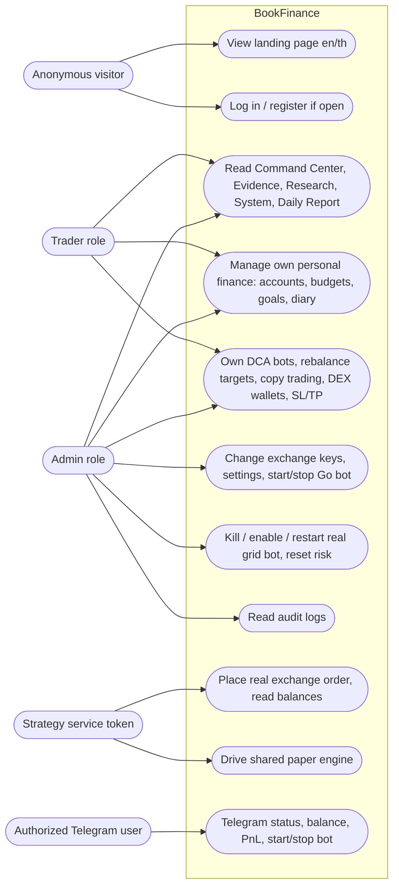

# 02 — Use Cases

Actors มาจาก access level ใน code จริง: `AccessPublic`, `AccessUser`, `AccessAdmin` และ `Service` ใน
`backend/internal/adapter/http/route_access.go` บวก role string `admin` / `trader` ใน `auth_handler.go`
และ Telegram user ที่ผ่านตาราง `telegram_users.is_authorized`

| Actor | มาจากไหนใน code | หมายเหตุ |
|---|---|---|
| Anonymous visitor | `isPublicRoute()` ใน `handler.go` | เข้าได้แค่ landing, `/api/health`, `/api/auth/login|register|config` |
| Trader (self-registered) | role `trader` จาก `Register` | registration ปิดเป็น default เมื่อ `ENVIRONMENT=production` (`registration.go`) |
| Admin (operator) | role `admin` เฉพาะบัญชี `FIRST_ADMIN_EMAIL` | คนเดียวที่ write ได้ใน `userReadAdmin` / `adminOnlyRule` |
| Strategy service | `Authorization: Bearer $AUTH_TOKEN` บน route ที่ `Service: true` | real grid bot, paper grid bot เรียก `/api/trade/*`, `/api/paper/*`, `/api/journal/*` |
| Telegram user | `telegram_users.is_authorized = true` | คำสั่ง `/status /balance /pnl /startbot /stopbot /paper` |

Sources: `backend/internal/adapter/http/route_access.go` (`routeAccess`, `userRule`, `userReadAdmin`, `adminOnlyRule`, `serviceRule`), `backend/internal/adapter/http/handler.go` (`isPublicRoute`, `ServeHTTP`), `backend/internal/adapter/http/auth_handler.go` (roles, `IsAdmin`), `backend/internal/adapter/http/registration.go`, `backend/internal/adapter/http/strategy_proxy.go` (privileged route list), `backend/internal/domain/service/telegram_bot_service.go` (`isAuthorized`, commands), `frontend/src/components/Sidebar.tsx` (core 5 pages), `frontend/src/services/auth.ts` (`isAdmin`).

ข้อสังเกต:
- Trader อ่าน endpoint `userReadAdmin` ได้ทั้งหมด (balances, orders, trades, settings ของ operator) — `docs/UPGRADE-PLAN.md` P2 บันทึกไว้แล้วว่าถ้าเปิด registration ต้องทำให้ read เหล่านี้ admin-only ก่อน.
- Telegram `/startbot` และ `/stopbot` เรียก `botService.Start/Stop` ตรงๆ (`cmd/main.go`) ไม่ผ่าน HTTP access matrix; การ authorize Telegram user ทำผ่าน `AuthorizeUser()` แต่ไม่พบ call site ใน backend.

## Reused

- Central flow pack layer 2 (operator storyboard) และ layer 6 (authz): `bookchaowalit/architecture-docs` → `docs/architecture/flows/booktrading-ui/02-operator-storyboard.md`, `06-authz-decision.md`. **Layer 6 ล้าสมัยแล้ว**: pack บอกว่า "publicRoutes allowlist ข้าม token check ของ trading API ส่วนใหญ่" และ "role never checked" — code ปัจจุบันมี access matrix (pass 9–13 ใน `docs/UPGRADE-PLAN.md`) ที่ public เฉพาะ 5 path และ check admin role ใน `ServeHTTP`.

## Open questions

- Telegram user ถูก authorize อย่างไรใน production (ไม่มี caller ของ `AuthorizeUser`, ไม่มี migration seed) — insert ตาราง `telegram_users` ด้วยมือหรือไม่?
- ต้องการให้ trader role มีอยู่จริงไหม หรือ product เป็น single-operator ถาวร (README Roadmap ยังมี "Multi-user support with RBAC").
