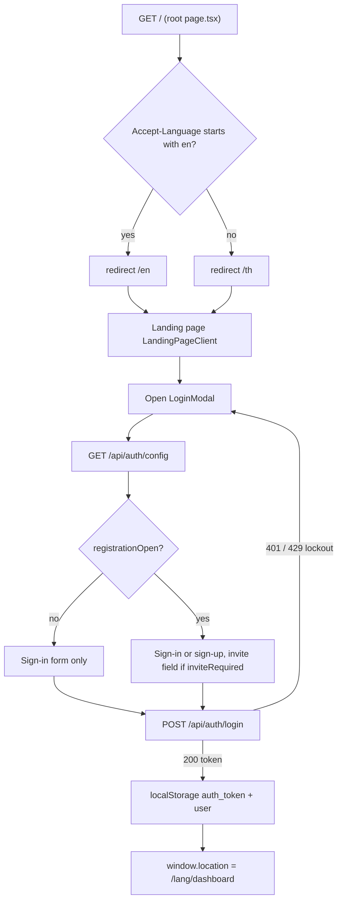
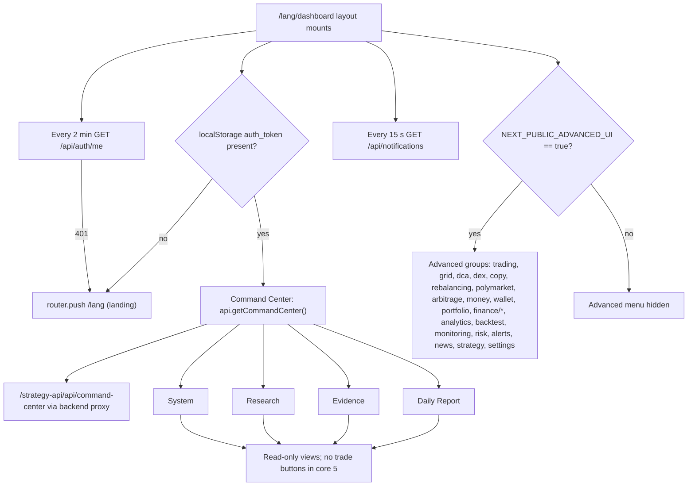
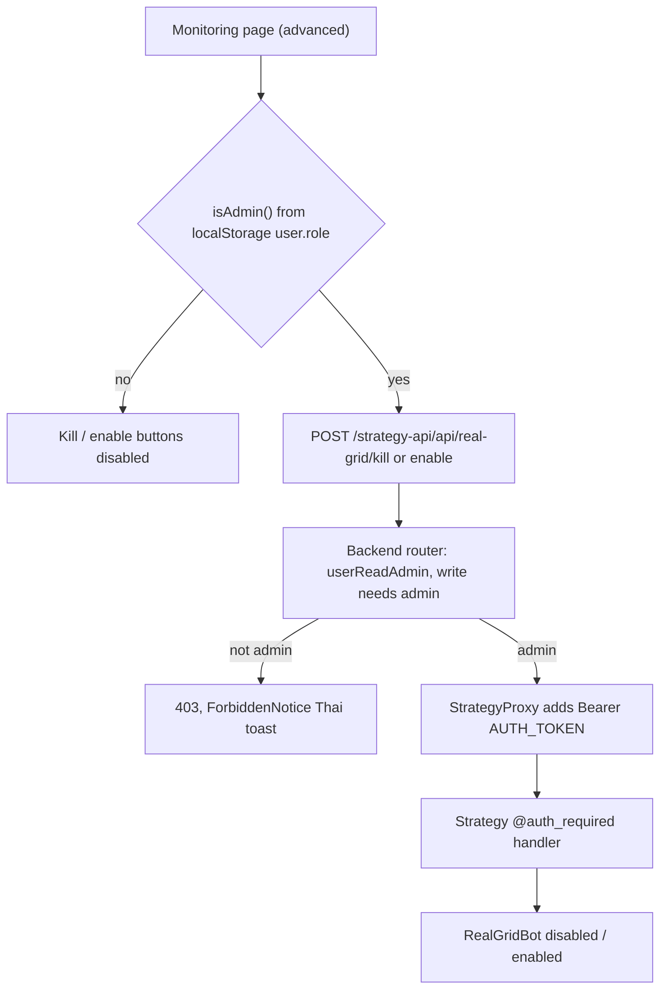

# 03 — User Flows

Frontend มี 42 ไฟล์ `page.tsx` (นับด้วย `find frontend/src/app -name page.tsx`): root redirect, `[lang]` landing,
`[lang]/dashboard` (Command Center) และหน้า dashboard ย่อย. Sidebar แบ่งเป็น **core 5 หน้า (observe-only)** และ
**advanced groups** ที่โชว์เฉพาะเมื่อ build ด้วย `NEXT_PUBLIC_ADVANCED_UI=true`

## Flow 1 — Visitor เข้าเว็บและ login

Sources: `frontend/src/app/page.tsx`, `frontend/src/app/[lang]/LandingPageClient.tsx`, `frontend/src/components/LoginModal.tsx`, `frontend/src/services/auth.ts` (`authenticate`, `getAuthConfig`, `register`), `backend/internal/adapter/http/auth_handler.go`, `backend/internal/adapter/http/registration.go`.

## Flow 2 — Operator ใช้ dashboard (observe-only default)

Sources: `frontend/src/app/[lang]/dashboard/layout.tsx` (auth check, `validateSession`, `fetchUnreadCount`), `frontend/src/components/Sidebar.tsx` (core items, `advancedGroups`, `isAdvancedUI`), `frontend/src/app/[lang]/dashboard/page.tsx`, `frontend/src/app/[lang]/dashboard/{daily-report,evidence,research,system}/page.tsx`, `frontend/src/services/api.ts` (`getCommandCenter`), `frontend/src/services/auth-headers.ts` (`STRATEGY_URL = /strategy-api`).

## Flow 3 — Admin หยุด / เปิด real grid bot

Sources: `frontend/src/app/[lang]/dashboard/monitoring/page.tsx` (`isAdmin`, `killBot`, `enableBot`), `frontend/src/services/monitoring.ts`, `frontend/src/services/forbidden.ts`, `frontend/src/components/ForbiddenNotice.tsx`, `backend/internal/adapter/http/route_access.go` (`StrategyProxyPrefix + "/": userReadAdmin`), `backend/internal/adapter/http/strategy_proxy.go`, `strategy/infrastructure/api/app.py` (`/api/real-grid/kill`, `/api/real-grid/enable`).

ข้อสังเกต:
- Frontend ไม่มี `middleware.ts` — การกันหน้า dashboard เป็น client-side `useEffect` เท่านั้น; ข้อมูลจริงถูกกันที่ backend (access matrix).
- บน live Vercel site ทุก `/api/*` ตอบ 502 (`DNS_HOSTNAME_NOT_FOUND`, ตรวจ 2026-11-03) ดังนั้น flow 1 หยุดที่ login ไม่ผ่าน และ flow 2–3 ใช้ได้เฉพาะ local / self-hosted compose.

## Reused

- Central flow pack layer 2: `bookchaowalit/architecture-docs` → `docs/architecture/flows/booktrading-ui/02-operator-storyboard.md` (5 screen clusters, นับ 37 dashboard page ที่ 8de42ee). ไฟล์นี้เพิ่ม split core/advanced ตาม `Sidebar.tsx` ซึ่ง pack ไม่ได้แยก.

## Open questions

- README บอก "38 routes: 5 keep-main, 14 extracted-to-component, 8 advanced-only, 11 hidden/deferred" — ไม่พบ list ใน code ว่า route ไหน hidden/deferred (บาง page ยังมีไฟล์อยู่แต่ไม่อยู่ใน Sidebar เช่น `history` อยู่ใน advanced). ต้องการ list ทางการจากเจ้าของ.
- Live Vercel build ตั้ง `NEXT_PUBLIC_ADVANCED_UI` หรือไม่ — `vercel env ls` (2026-11-03) เห็นแค่ `NEXT_PUBLIC_SENTRY_DSN`.
