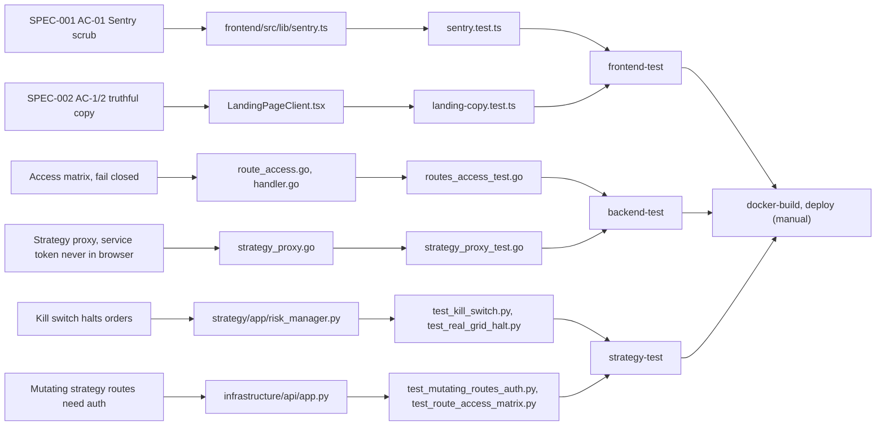

# 04 — Requirements Traceability Matrix (RTM)

Requirement มาจาก `specs/` (SPEC-001, SPEC-002), safety requirement ที่ README / `strategy/RUNBOOK.md` ระบุ
และงานที่ `docs/UPGRADE-PLAN.md` บันทึกว่า "Done" พร้อมชื่อ test. Release column = job ใน `.github/workflows/ci-cd.yml`
ที่รัน test นั้น และช่องทาง deploy จริง

Sources: `specs/001-shared-ci-sentry-deps/spec.md`, `specs/002-truthful-landing-copy/spec.md`, `docs/UPGRADE-PLAN.md`, `.github/workflows/ci-cd.yml`, test files ตามตาราง.

| Req ID | Requirement (source) | Code module | Test file | CI job / release |
|---|---|---|---|---|
| SPEC-001 AC-01 | Sentry off without DSN; errors only; request/user/breadcrumbs/extra/locals stripped (`specs/001…`) | `frontend/src/lib/sentry.ts`, `frontend/src/instrumentation*.ts` | `frontend/src/lib/sentry.test.ts` | `frontend-test` (shared `ci-node.yml` v1.1.1); live via Vercel CLI deploy |
| SPEC-001 AC-02 | Strategy behaviour unchanged on fastapi/pydantic/uvicorn bumps | `strategy/pyproject.toml`, `strategy/uv.lock` | `strategy/tests/*` (offline suite) + `strategy/research/tests/*` | `strategy-test` (shared `ci-python.yml`) |
| SPEC-001 AC-03 | Backend unchanged on Go module upgrades | `backend/go.mod` | `backend/**/*_test.go` (`go test -race`) | `backend-test` |
| SPEC-001 AC-04 | No unreviewed vuln / HIGH misconfig | `.trivyignore.yaml`, `frontend/osv-scanner.toml` | — (scanner) | `security` (shared `security.yml`) |
| SPEC-002 AC-1/AC-2 | Landing copy says rule-based bots, paper mode (en/th) | `frontend/src/app/[lang]/LandingPageClient.tsx` | `frontend/src/app/[lang]/landing-copy.test.ts` | `frontend-test`; live Vercel deploy 2026-10-23 or later (not tied to SHA) |
| SPEC-002 AC-3 | Layout metadata no longer "AI Financial Operating System" | `frontend/src/app/[lang]/layout.tsx` | review only (spec says so) | — |
| UP-P11 | Every ServeMux pattern classified; unlisted fails closed | `backend/internal/adapter/http/route_access.go` | `routes_access_test.go`, `auth_boundary_test.go` | `backend-test` |
| UP-P12 | Registration closed in production; invite code | `registration.go` | `registration_test.go`, `frontend/src/services/auth-config.test.ts`, `frontend/src/components/LoginModal.test.tsx` | `backend-test`, `frontend-test` |
| UP-P13 | Login lockout per (email, IP), trusted proxies | `auth_handler.go`, `client_ip.go` | `login_lockout_test.go` | `backend-test` |
| UP-P10 | Users persist in `users` table | `backend/internal/adapter/database/users.go` | `auth_persistence_test.go`, `users_db_test.go` (env-gated, not in CI) | `backend-test` (partial) |
| UP-P8/9 | `/strategy-api` proxy, writes admin-only | `strategy_proxy.go` | `strategy_proxy_test.go`, `frontend/src/services/strategy-services-auth.test.ts` | `backend-test`, `frontend-test` |
| UP-P1 | Kill-switch / circuit-breaker reset fail closed | `strategy/infrastructure/api/app.py` | `strategy/tests/test_safety_reset_auth.py` | `strategy-test` |
| UP-P1 | Real/dca/trend bots default to safety mode | strategy bots | `strategy/tests/test_mainnet_default.py` | `strategy-test` |
| UP-P3 | `require_auth` fails closed in production without `AUTH_TOKEN` | `app.py` `require_auth` | `strategy/tests/test_require_auth_production.py` | `strategy-test` |
| UP-P2/4/5 | Grid idempotency, reconcile unknown order outcome | `backend/internal/domain/service/grid_orders.go`, `adapter/exchange/order_reconcile.go`, `bitkub_reconcile.go` | `grid_position_test.go`, `grid_reconcile_test.go`, `order_reconcile_test.go`, `bitkub_reconcile_test.go`, `orders_v3_test.go` | `backend-test` |
| README safety | Kill switch halts on drawdown; real grid disabled on halt | `strategy/app/risk_manager.py` (`check_order_allowed`, `_halt`) | `test_kill_switch.py`, `test_real_grid_halt.py`, `test_safety_filters.py` | `strategy-test` |
| README safety | Futures mainnet refused | `strategy/app/futures_bot.py` | `test_futures_safety.py` | `strategy-test` (ruff full rules on this file) |
| README contract | `/api/command-center` shape | `app.py` `/api/command-center` | `frontend/src/test/contract.test.ts`; `strategy/tests/test_command_center_contract.py` (integration, **excluded in CI**) | `frontend-test` only |
| KPI plan | KPI-O-01, KPI-G-01/02 measured monthly | `durable_journal.py`, `metrics.go` | none (queries not written, KPI-PLAN row 1–2) | none |

## Reused

- Central flow pack layer 8: `bookchaowalit/architecture-docs` → `docs/architecture/flows/booktrading-ui/08-uat-traceability.md`. ตัวเลขใน pack (pytest 127 passed / 9 failed / 16 errored, `go test` fail ที่ `cmd/migrate`) เป็น run วันที่ 2026-08-19 ที่ 8de42ee; หลังจากนั้น `docs/UPGRADE-PLAN.md` pass 11 บันทึก "strategy pytest 655 passed" และ CI `CI/CD Pipeline` บน main เป็น success ทุก run ตั้งแต่ 2026-10-15 07:02 UTC (`gh run list`).

## Open questions

- ไม่มี requirement ID ทางการก่อน SPEC-001 (2026-10-22); งานก่อนหน้าอยู่ใน `docs/UPGRADE-PLAN.md` เป็น pass — ใช้ ID `UP-Pn` ในตารางนี้เพื่ออ้างอิงเท่านั้น.
- Release ที่ deploy จริงไม่มี tag / SHA (Vercel CLI deploy, compose host ไม่ทราบ) จึงตอบไม่ได้ว่า requirement ไหนอยู่บน production แล้ว.
