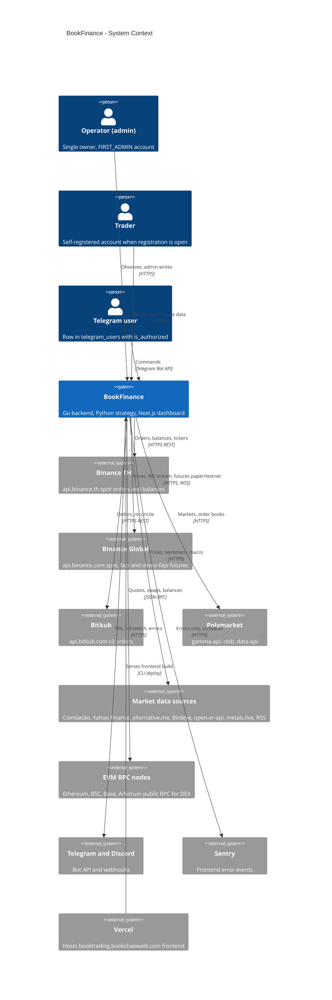

# 05 — C4 Level 1: System Context

BookFinance อยู่ตรงกลาง; คนที่ใช้มี 3 แบบ (operator/admin, trader, Telegram user) และพึ่งพา exchange,
market data, notification และ hosting ภายนอก. ทุก external ข้างล่างมี URL หรือ SDK อยู่ใน code

Sources: `backend/cmd/main.go`, `backend/internal/adapter/exchange/binance_adapter.go`, `backend/internal/adapter/exchange/binance_th_adapter.go`, `backend/internal/adapter/exchange/bitkub/`, `backend/internal/config/config.go` (EVM RPC URLs), `backend/internal/adapter/http/news_handler.go` (CoinGecko, alternative.me), `backend/internal/domain/service/alert_service.go`, `backend/internal/domain/service/telegram_bot_service.go`, `strategy/app/polymarket/client.py`, `strategy/app/market_intel/sources/` (`macro.py`, `stocks.py`, `degen.py`, `binance_alpha.py`), `strategy/app/futures_bot.py` (`fapi`, `demo-fapi`), `strategy/app/webhook_notifier.py`, `frontend/src/lib/sentry.ts`, `specs/001-shared-ci-sentry-deps/spec.md` (Vercel project `booktrading-frontend`).

หมายเหตุ: `strategy/app/world/client.py` เรียก `markets-api-proxy.world-xyz.workers.dev` (world markets) — รวมอยู่ใน "Market data sources" เพื่อไม่ให้ภาพแน่นเกิน.

## Open questions

- External ไหน "เปิดใช้จริง" บน production ขึ้นกับ env (`DEX_ENABLED`, `FUTURES_ENABLED`, `TELEGRAM_BOT_TOKEN`, `DISCORD_WEBHOOK_URL`, `MARKET_INTEL_ONCHAIN_STREAM_ENABLED`) — ไม่ทราบค่าบน host จริง.
