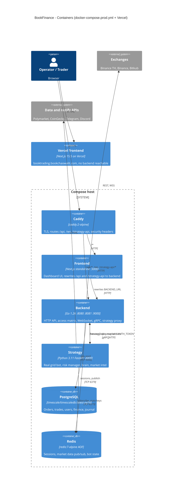

# 06 — C4 Level 2: Containers

Container มาจาก `docker-compose.prod.yml` (6 service) บวก Vercel frontend ที่เป็น live site จริง.
พอร์ตตาม compose: backend HTTP 8080, WS 8081, gRPC 9000 (bind 127.0.0.1), strategy 8000 (host 127.0.0.1:8001), Caddy 80/443

Sources: `docker-compose.prod.yml`, `Caddyfile`, `frontend/next.config.js` (rewrites, `output: 'standalone'`), `frontend/package.json` (next 15.5.28), `backend/go.mod` (go 1.26.8), `backend/cmd/main.go` (HTTP/WS/gRPC servers, strategy proxy), `strategy/Dockerfile`, `strategy/infrastructure/api/app.py` (`lifespan`: gRPC client, Redis adapter, bots), `strategy/app/real_grid_bot.py` (`BACKEND_API_BASE`), `strategy/app/backend_auth.py`, `backend/internal/adapter/redis/redis_adapter.go`, `specs/001-shared-ci-sentry-deps/spec.md` §5.

ข้อสังเกต:
- Vercel frontend ใช้ `next.config.js` ชุดเดียวกัน แต่ไม่มี `BACKEND_URL` ใน Vercel env (`vercel env ls --project booktrading-frontend` เห็นแค่ `NEXT_PUBLIC_SENTRY_DSN`, 2026-11-03) ทำให้ rewrite ไปที่ `http://backend:8080` และตอบ 502 `DNS_HOSTNAME_NOT_FOUND`.
- `docker-compose.yml` (dev) มี container เดียวกันแต่ชื่อ `trading-bot-*` และ frontend publish ที่ `3001`; ไม่มี Caddy.
- Strategy ใช้ SQLite local (`DurablePaperJournal`) สำหรับ alpha review lane ผ่าน `strategy/scripts/world_alpha_*.py` — ไม่ใช่ container แยก.

## Open questions

- Compose host จริง (`/opt/bookfinance` ใน deploy job) คือเครื่องไหน และยังรันอยู่หรือไม่ — repo ไม่มีข้อมูล; `Caddyfile` ยังเป็น `your-domain.com`.
