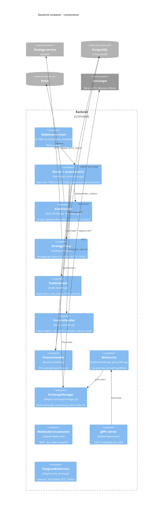
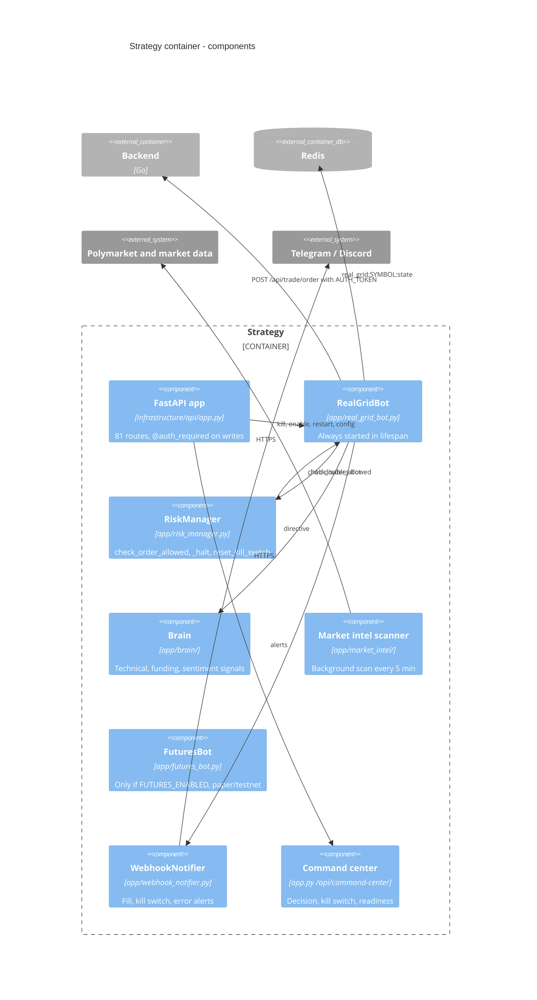

# 07 — C4 Level 3: Components

แยก 2 container ที่มี logic มากที่สุด: Go backend (hexagonal: `adapter/`, `domain/service`, `port/`) และ Python strategy

## Backend (Go)

Sources: `backend/cmd/main.go` (wiring order, middleware chain), `backend/internal/adapter/http/handler.go`, `route_access.go`, `auth_handler.go`, `registration.go`, `strategy_proxy.go`, `trade_handler.go`, `feature_handler.go`, `finance_handler.go`, `audit_middleware.go`, `security_middleware.go`, `backend/internal/domain/service/implementation.go`, `grid_orders.go`, `telegram_bot_service.go`, `backend/internal/adapter/exchange/manager.go`, `backend/internal/adapter/websocket/broadcaster.go`, `backend/internal/adapter/grpcserver/grpc_server.go`, `proto/trading.proto`.

## Strategy (Python)

Sources: `strategy/infrastructure/api/app.py` (`lifespan`, `require_auth`, routes), `strategy/tests/test_route_access_matrix.py` (81 method/path pairs ตาม `docs/UPGRADE-PLAN.md` pass 11), `strategy/app/real_grid_bot.py`, `strategy/app/risk_manager.py`, `strategy/app/brain/brain.py`, `strategy/app/market_intel/scanner.py`, `strategy/app/futures_bot.py`, `strategy/app/webhook_notifier.py`, `strategy/app/backend_auth.py`.

## Open questions

- Go `RiskManager` (`backend/internal/domain/service/risk_manager.go`) ใช้แค่ใน `/api/risk/check` และ backtest; ไม่ได้ gate `OrderService.CreateOrder` หรือ `/api/trade/order` — ตั้งใจให้ gate อยู่ฝั่ง Python อย่างเดียวหรือไม่?
