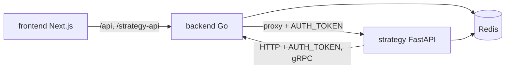

# ADR-0001 — แยก 3 service: Go backend, Python strategy, Next.js frontend

- Status: accepted (retro-documented 2026-11-03)
- Deciders: owner (bookchaowalit); บันทึกย้อนหลังจาก code

## Context

ระบบต้องทั้ง (1) ถือ exchange account, รับ order, สตรีมราคา, WebSocket ไปหา UI และ (2) รัน strategy / research
ที่ใช้ ecosystem ด้าน data (indicators, backtest, Polymarket analysis). PRODUCT.md ระบุว่า "Go for the HTTP/WebSocket/gRPC
server, Python for the strategy/prediction layer"

## Decision

- `backend/` = Go (module `trading-bot-system/backend`, `go 1.26.8`) — HTTP :8080, WebSocket :8081, gRPC :9000, hexagonal layout `adapter/ domain/ port/`.
- `strategy/` = Python 3.11 FastAPI (`uvicorn`), bots รันเป็น asyncio task ใน `lifespan`.
- `frontend/` = Next.js 15.5 + React 19, `output: 'standalone'`, i18n `[lang]` en/th.
- สื่อสารกันด้วย HTTP (strategy → backend `/api/trade/*` + `AUTH_TOKEN`; backend → strategy ผ่าน `/strategy-api` proxy), gRPC (`proto/trading.proto`) และ Redis pub/sub.

## Consequences

- ดี: ภาษาเหมาะกับงาน; safety test ของ strategy (pytest) แยกจาก Go (`go test -race`).
- เสีย: logic ซ้ำสองฝั่ง — มี risk manager ทั้ง Go (`backend/internal/domain/service/risk_manager.go`) และ Python (`strategy/app/risk_manager.py`), paper engine ฝั่ง Go กับ paper bots ฝั่ง Python; CI ต้องมี 3 job + security.

## Evidence

`PRODUCT.md`, `backend/go.mod`, `backend/cmd/main.go`, `strategy/app/main.py`, `strategy/infrastructure/api/app.py`, `frontend/package.json`, `frontend/next.config.js`, `proto/trading.proto`, `docker-compose.prod.yml`, `.github/workflows/ci-cd.yml`.
