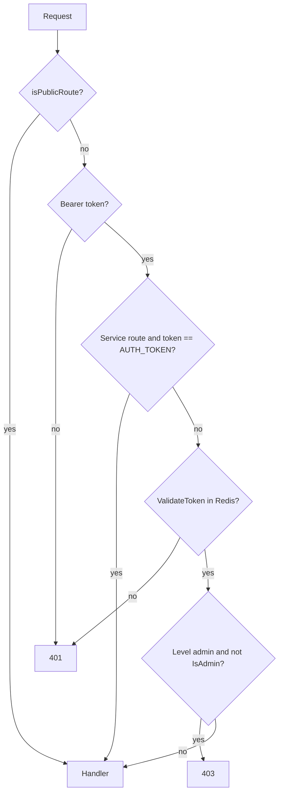

# ADR-0003 — Opaque session token + route access matrix แบบ fail-closed

- Status: accepted (retro-documented 2026-11-03)

## Context

ระบบเป็น single-tenant: exchange key, bots, paper engine ใช้ร่วมกันทั้ง server. ก่อน pass 11 (`docs/UPGRADE-PLAN.md`)
self-registered user สามารถ place real order และเปลี่ยน exchange key ได้

## Decision

- Login (bcrypt) ออก token = 32 random bytes → SHA-256 hex (ไม่ใช่ JWT), เก็บใน Redis TTL 7 วัน; frontend เก็บใน `localStorage.auth_token` แล้วส่ง `Authorization: Bearer`.
- ทุก ServeMux pattern ต้องอยู่ใน `routeAccess` (`route_access.go`) ระดับ public / user / admin (+ `Service` สำหรับ `AUTH_TOKEN`); pattern ที่ไม่อยู่ใน map ได้ `unclassifiedRule` (read = user, write = admin). `routes_access_test.go` fail CI ถ้ามี pattern ที่ไม่ classify.
- Admin มีคนเดียว: บัญชี `FIRST_ADMIN_EMAIL`; registration ปิดเมื่อ `ENVIRONMENT=production` เว้นแต่ `ALLOW_REGISTRATION` / `REGISTRATION_INVITE_CODE`.

## Consequences

- Token ใน `localStorage` อ่านได้ถ้ามี XSS (ไม่มี httpOnly); CSP ใน `Caddyfile` อนุญาต `'unsafe-inline' 'unsafe-eval'`.
- WebSocket รับ token ทาง query `?token=` (`broadcaster.go`) ซึ่งอาจไปอยู่ใน access log.
- Lockout เก็บใน memory ของ process (UPGRADE-PLAN P1 ให้ย้ายไป Redis).

## Evidence

`backend/internal/adapter/http/auth_handler.go`, `route_access.go`, `handler.go` (`ServeHTTP`, `isPublicRoute`), `registration.go`, `routes_access_test.go`, `frontend/src/services/auth.ts`, `frontend/src/services/auth-headers.ts`, `backend/internal/adapter/websocket/broadcaster.go`, `docs/UPGRADE-PLAN.md` pass 9–13.
