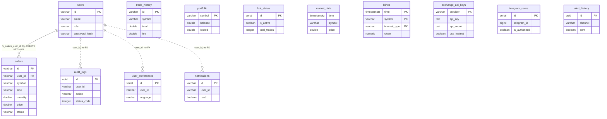
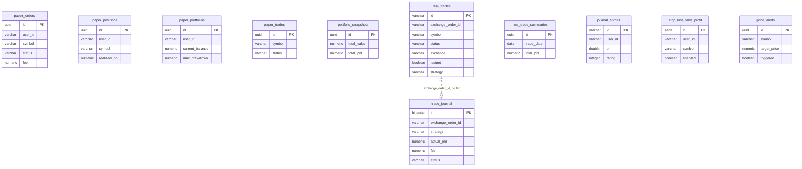
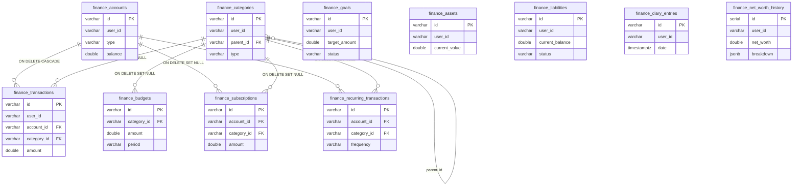
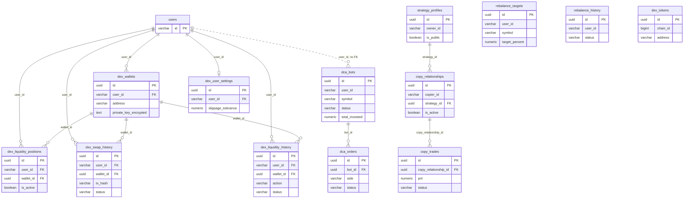

# 09 — ERD

Schema มาจาก 22 migration ใน `backend/migrations/*.up.sql` (golang-migrate). มี 48 ตาราง จึงแบ่งเป็น 4 ภาพตาม domain.
เส้นทึบ (`--`) = foreign key ที่ประกาศจริงใน migration; เส้นประ (`..`) = ความสัมพันธ์เชิง logic ผ่าน `user_id` / `exchange_order_id`
ที่ **ไม่มี** FK constraint. แสดงเฉพาะ column สำคัญ (PK, FK, status, เงิน) — column ทั้งหมดดูใน migration

## 1. Users, trading core, system

Sources: `backend/migrations/001_init_schema.up.sql`, `003_add_user_support.up.sql`, `004_add_user_preferences.up.sql`, `005_add_journal_notifications_sltp.up.sql`, `006_add_exchange_api_keys.up.sql`, `008_add_users_table.up.sql`, `009_add_audit_table.up.sql`, `011_add_klines.up.sql`, `012_add_telegram_users.up.sql`, `014_add_alert_history.up.sql`, `022_fix_orders_user_id_default.up.sql`.

## 2. Paper, real trades, journal, risk

Sources: `backend/migrations/005_add_journal_notifications_sltp.up.sql`, `013_add_paper_trading_tables.up.sql`, `018_add_real_trading_tables.up.sql`, `019_add_trade_journal.up.sql`, `020_add_portfolio_snapshots_and_price_alerts.up.sql`, `021_add_paper_trades_compatibility.up.sql`; join `real_trades` ↔ `trade_journal` ผ่าน `exchange_order_id` ตามที่ `docs/EVIDENCE_LOG.md` 2026-07-23 ใช้ตรวจ.

## 3. Personal finance (per user)

Sources: `backend/migrations/007_add_finance_module.up.sql`. ทุกตาราง finance มี `user_id` แต่ไม่มี FK ไป `users`.

## 4. Bots, copy trading, rebalancing, DEX

Sources: `backend/migrations/010_add_dca_bots.up.sql`, `015_add_copy_trading.up.sql`, `016_add_portfolio_rebalancing.up.sql`, `017_add_dex_support.up.sql`.

## Persisted data นอก Postgres

| Store | ข้อมูล | Source |
|---|---|---|
| Redis | session token → userID (TTL 7 วัน), market data channel, `real_grid:{symbol}:state` | `backend/internal/adapter/redis/redis_adapter.go`, `strategy/app/real_grid_bot.py` |
| SQLite local | `alpha_policy`, `alpha_reviews` … (paper review lane) | `strategy/app/alpha/durable_journal.py` |

## Open questions

- `exchange_api_keys.api_key/api_secret` เข้ารหัส AES-256-GCM ด้วย key ที่ derive จาก `ENCRYPTION_KEY` (`backend/internal/adapter/database/api_keys.go`) — มี rotation plan หรือไม่?
- `dex_wallets.private_key_encrypted`: AES-256-GCM, key จาก `DEX_WALLET_ENCRYPTION_KEY` (HKDF) ตั้งแต่ 2026-11-03. Row ที่สร้างก่อนนั้นใช้ key คงที่ซึ่งอยู่ใน git history — ต้อง re-key ด้วย `backend/cmd/rekey-dex-wallets` (ดู [13-threat-model](13-threat-model.md)).
- `finance_recurring_transactions` สร้าง repository แต่ "Initialized but not yet wired" (`cmd/main.go`) — ยังต้องการหรือไม่?
