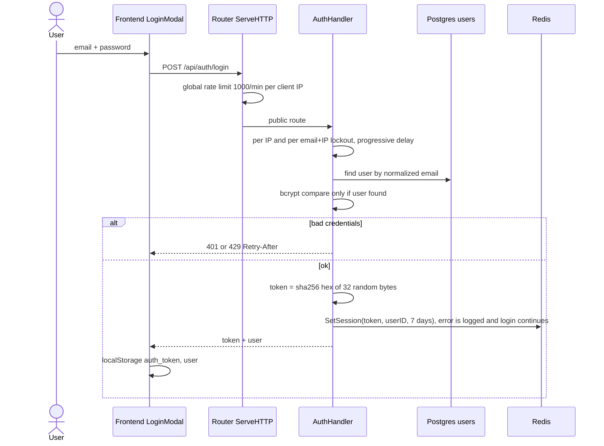
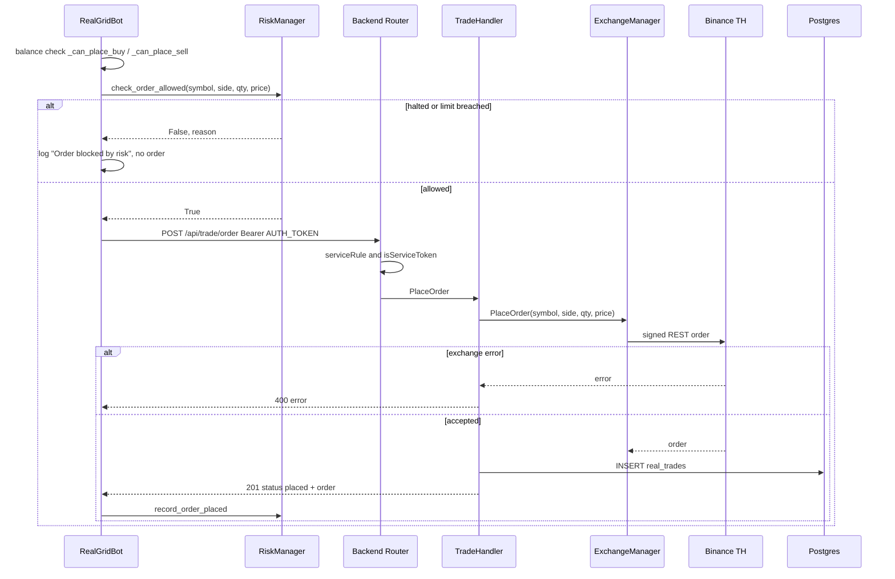
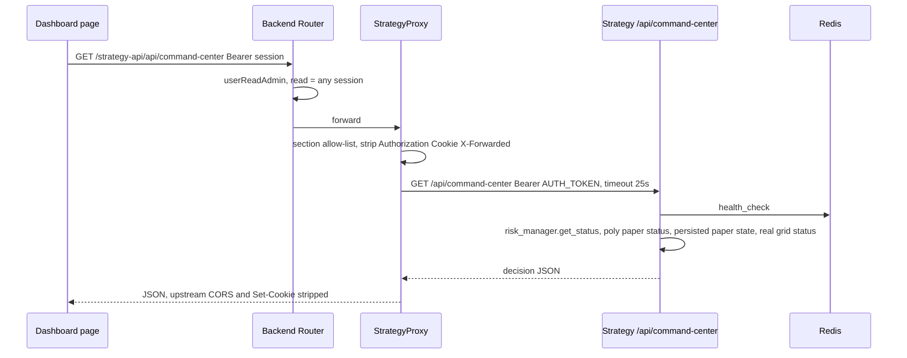
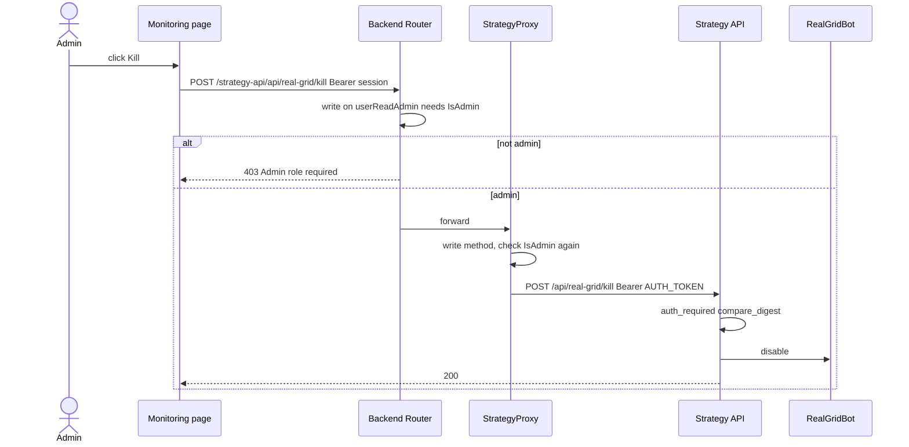

# 10 — Sequence Diagrams

4 request path ที่สำคัญที่สุด: login, real grid order (เงินจริง), dashboard อ่าน command center ผ่าน proxy, และ admin kill switch

## 1. Login

Sources: `frontend/src/components/LoginModal.tsx`, `frontend/src/services/auth.ts`, `backend/internal/adapter/http/handler.go` (`globalRateLimiter`, `ServeHTTP`), `backend/internal/adapter/http/auth_handler.go` (`Login`, `sessionTTL`, lockout functions), `backend/internal/adapter/http/client_ip.go`, `backend/internal/adapter/redis/redis_adapter.go` (`SetSession`), `docs/UPGRADE-PLAN.md` pass 13.

## 2. Real grid order (real money path)

Sources: `strategy/app/real_grid_bot.py` (order placement block around `check_order_allowed` and `POST {BACKEND_API_BASE}/api/trade/order`), `strategy/app/backend_auth.py`, `strategy/app/risk_manager.py`, `backend/internal/adapter/http/route_access.go` (`/api/trade/order: serviceRule`), `backend/internal/adapter/http/handler.go`, `backend/internal/adapter/http/trade_handler.go` (`PlaceOrder`, `persistTrade`), `backend/internal/adapter/exchange/manager.go`.

## 3. Dashboard reads Command Center via strategy proxy

Sources: `frontend/src/services/api.ts` (`getCommandCenter`), `frontend/src/app/[lang]/dashboard/page.tsx`, `backend/internal/adapter/http/strategy_proxy.go`, `backend/internal/adapter/http/route_access.go`, `strategy/infrastructure/api/app.py` (`command_center`), `docs/UPGRADE-PLAN.md` pass 8.

## 4. Admin presses kill on the real grid bot

Sources: `frontend/src/app/[lang]/dashboard/monitoring/page.tsx`, `frontend/src/services/monitoring.ts` (`killBot`), `backend/internal/adapter/http/handler.go`, `backend/internal/adapter/http/strategy_proxy.go` (privileged routes), `strategy/infrastructure/api/app.py` (`/api/real-grid/kill`, `require_auth`).

## Reused

- Central flow pack layer 3 / 7: `bookchaowalit/architecture-docs` → `docs/architecture/flows/booktrading-ui/03-system-sequence.md`, `07-error-retry.md`. Login sequence ใน pack ยังถูกในส่วน token / TTL / localStorage แต่ lockout เปลี่ยนแล้ว (per-IP + per email+IP + progressive delay). Order sequence ใน pack ให้ Go `service/implementation.go` เรียก `risk_manager.py check_order_allowed()` — ไม่พบใน code; ภาพที่ 2 ข้างบนคือ path จริง.

## Open questions

- Login: code ปัจจุบัน `found == nil || bcrypt.Compare...` ข้าม bcrypt เมื่อไม่พบ email จึงยังตอบเร็วกว่า (UPGRADE-PLAN P1 ยังเปิด) แม้ pass 13 จะทำ status/body/delay/lockout ให้เท่ากัน — ยืนยันว่ายอมรับ timing leak นี้ชั่วคราวหรือไม่.
- ถ้า `SetSession` ล้มเหลว (Redis down) login ยังคืน token ที่ `ValidateToken` จะไม่รู้จัก — user จะได้ 401 ทันทีที่เรียก API ถัดไป.
