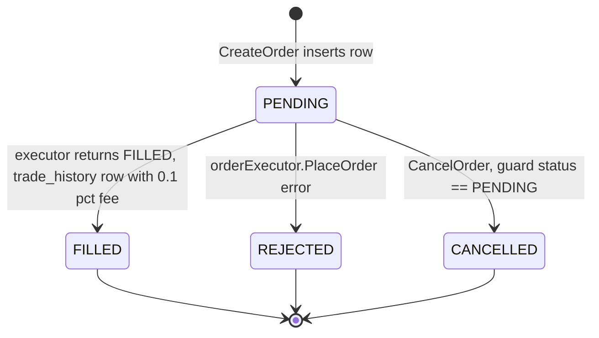
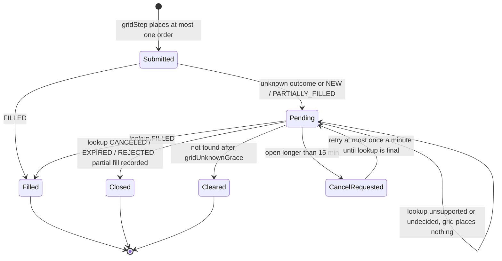
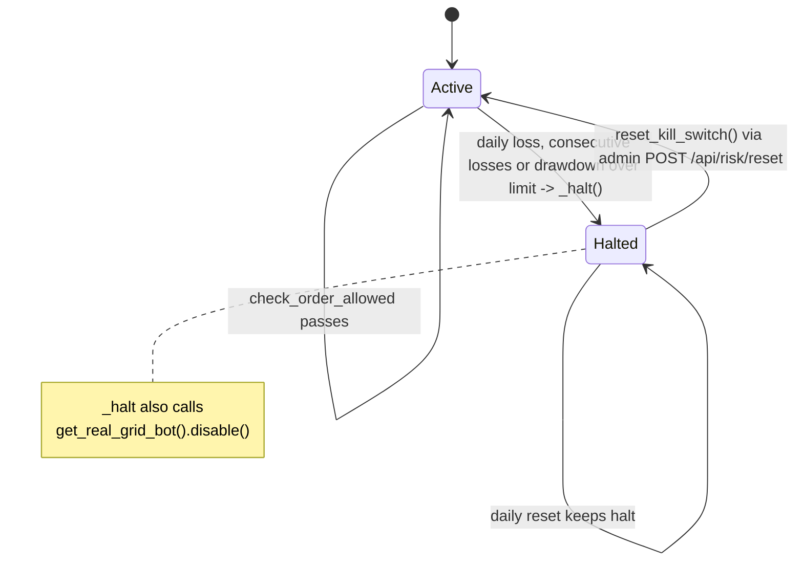
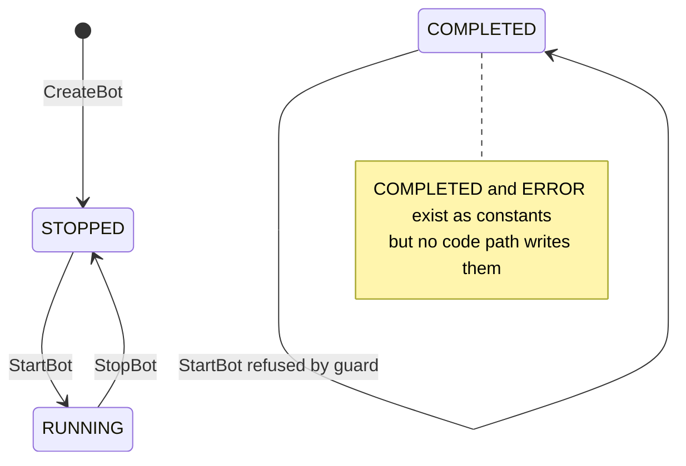
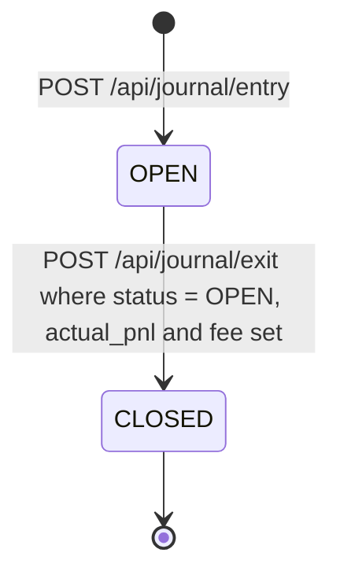

# 11 — State Machines

Entity ที่มี status / lifecycle field จริงใน code และ migration

## 1. Order (`orders.status`, Go `OrderStatus`)

Sources: `backend/internal/domain/model/models.go` (`OrderStatus*`), `backend/internal/domain/service/implementation.go` (`CreateOrder`, `CancelOrder`), `backend/migrations/001_init_schema.up.sql` (`DEFAULT 'PENDING'`).

## 2. Go grid order in `gridBook` (reconcile by client order ID)

Sources: `backend/internal/domain/service/grid_orders.go` (header comment, `gridOrderMaxAge`, `gridCancelRetry`, `reconcileGridOrder`), `backend/internal/adapter/exchange/order_reconcile.go`, `backend/internal/adapter/exchange/bitkub_reconcile.go`, tests `grid_reconcile_test.go`, `order_reconcile_test.go`.

## 3. Strategy kill switch (`RiskState.halted`)

Sources: `strategy/app/risk_manager.py` (`check_order_allowed`, `_check_daily_reset`, `_halt`, `reset_kill_switch`), `strategy/infrastructure/api/app.py` (`/api/risk/reset`), `backend/internal/adapter/http/strategy_proxy.go` (reset is admin-only), `strategy/tests/test_kill_switch.py`, `strategy/tests/test_real_grid_halt.py`.

## 4. DCA bot (`dca_bots.status`)

Sources: `backend/internal/domain/model/dca.go`, `backend/internal/domain/service/dca_service.go` (create sets `STOPPED`, start guard on `COMPLETED`, start sets `RUNNING`, stop sets `STOPPED`), `backend/migrations/010_add_dca_bots.up.sql`.

## 5. Trade journal (`trade_journal.status`)

Sources: `backend/internal/adapter/http/trade_handler.go` (`JournalEntry`, `JournalExit`, `JournalStats`), `backend/migrations/019_add_trade_journal.up.sql`.

## Other status fields (values only, no transition logic found)

| Field | Values | Source |
|---|---|---|
| `paper_orders.status` / `PaperOrderStatus` | `PENDING`, `FILLED`, `CANCELLED` (no `REJECTED`) | `model/paper_trading.go`, migration 013 |
| `real_trades.status` | default `PENDING`; `persistTrade` writes `FILLED` for MARKET (price 0) and `NEW` for LIMIT — assumed, not read from the exchange; cancel sets `CANCELLED` | `trade_handler.go`, migration 018 |
| `finance_goals.status` | `active`, `completed`, `paused`, `cancelled` | `model/finance_models.go`, migration 007 |
| `finance_liabilities.status` | `active`, `paid_off`, `defaulted` | `model/finance_models.go`, migration 007 |
| `copy_trades.status` | default `OPEN` | migration 015 |
| `dex_swap_history.status`, `dex_liquidity_history.status` | default `pending` | migration 017 |
| `rebalance_history.status` | default `COMPLETED` | migration 016 |

## Reused

- Central flow pack layer 4: `bookchaowalit/architecture-docs` → `docs/architecture/flows/booktrading-ui/04-state-machine.md`. Bug ที่ pack บันทึก (`paper_bot.py reset_kill_switch()` → `RuntimeError: no running event loop`) **แก้แล้ว** ใน code ปัจจุบัน: `reset_kill_switch` ใน `strategy/app/polymarket/paper_bot.py` ครอบ `asyncio.get_running_loop()` ด้วย `try/except RuntimeError` แล้ว return. Pack อ้าง path `strategy/core/risk_manager.py` แต่ไฟล์จริงคือ `strategy/app/risk_manager.py`.

## Open questions

- DCA `ERROR` / `COMPLETED` ไม่มีที่เขียน — ตั้งใจ (ยังไม่ทำ) หรือ dead constant?
