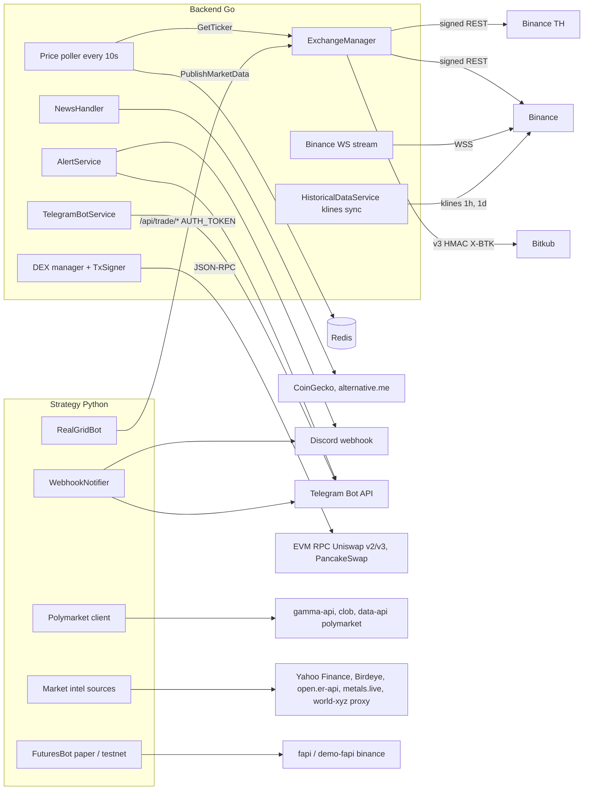

# 12 — API and Integrations

API reference แบบละเอียดมีอยู่แล้วใน [`API.md`](../../API.md) (reused สำหรับ request/response ตัวอย่าง). ไฟล์นี้สรุป endpoint group
ตาม access level จริง และ integration ภายนอกพร้อม flow

## Endpoint groups — backend (Go, :8080)

| Group | Patterns | Access (read / write) | Handler |
|---|---|---|---|
| Health, auth | `/api/health`, `/api/auth/login`, `/register`, `/config` | public | `handler.go`, `auth_handler.go` |
| Session | `/api/auth/me`, `/logout` | user | `auth_handler.go` |
| Orders, Go bot, portfolio, trades, performance, trading | `/api/orders*`, `/api/bot/*`, `/api/portfolio`, `/api/trades`, `/api/performance`, `/api/trading/*` | user / admin | `handler.go`, `trading_handler.go`, `performance_handler.go` |
| Exchange, settings | `/api/exchange*`, `/api/settings/*` | user / admin | `exchange_handler.go`, `settings_handler.go` |
| Market data | `/api/news`, `/api/sentiment/`, `/api/signals`, `/api/market/sentiment` | user / admin | `news_handler.go` |
| Notifications, manual journal | `/api/notifications*`, `/api/journal`, `/api/journal/` | user / admin | `notification_handler.go`, `journal_handler.go` |
| SL/TP | `/api/sltp*` | user / user | `sltp_handler.go` |
| Personal finance | `/api/finance/*` (28 patterns) | user / user | `finance_handler.go` |
| Paper engine | `/api/paper/order`, `/reset`, `/update-price`, `/orders`, `/cancel`, `/seed` | user / admin + **service** | `feature_handler.go` |
| Risk, alerts, backtest, metrics | `/api/risk/*`, `/api/alerts/*`, `/api/price-alerts*`, `/api/backtest/*`, `/api/metrics` | user / admin (`/api/risk/check` user) | `feature_handler.go` |
| Audit | `/api/audit/logs`, `/stats` | admin / admin | `feature_handler.go` |
| Real trading + bot journal | `/api/trade/*` (except ticker), `/api/journal/entry|exit|list|stats` | user / admin + **service** | `trade_handler.go` |
| DEX | `/api/dex/*` | user / user (`provider/switch` admin write) | `dex_handler.go` |
| Per-user bots | `/api/dca/bots`, `/api/rebalance/*`, `/api/copy/*`, `/api/dashboard/money` | user | `dca_handler.go`, `rebalancing_handler.go`, `copy_trading_handler.go`, `money_handler.go` |
| Strategy proxy | `/strategy-api/*` | user / admin | `strategy_proxy.go` |
| WebSocket | `:8081/ws?token=` | valid session | `adapter/websocket/broadcaster.go` |
| gRPC | `:9000` `TradingService` (SubscribeMarketData, ExecuteOrder, CancelOrder, Get/Start/StopBot), DEX service (GetQuote, Swap, GetTokenInfo, GetBalance) | network only (bind 127.0.0.1 / compose network) | `adapter/grpcserver/`, `proto/trading.proto` |

Sources: `backend/internal/adapter/http/route_access.go`, `backend/internal/adapter/http/handler.go`, handler files ตามตาราง, `backend/cmd/main.go`, `proto/trading.proto`.

## Endpoint groups — strategy (FastAPI, :8000, reached via `/strategy-api`)

Sections ที่ proxy ยอมให้ผ่าน: `airdrop-tracker, arb-paper, backtest, brain, command-center, evidence, grid, health, indicators, journal, market-intel, paper, poly-paper, real-grid, report, research, risk, signal-tracker, signals, strategy`.
ไม่ผ่าน proxy: `/api/ai/*`, `/api/arbitrage/*`, `/api/v1/world/*`, `/api/polymarket/*`, `/api/dca/status`, `/api/trend/status`, `/api/futures/*`, `/api/strategies`.

Sources: `backend/internal/adapter/http/strategy_proxy.go` (`strategyAllowedSections`), `strategy/infrastructure/api/app.py` (route decorators), `strategy/app/prediction_api.py`, `strategy/app/arbitrage_api.py`.

## Integration flows

Sources: `backend/internal/adapter/exchange/manager.go`, `binance_adapter.go`, `binance_th_adapter.go`, `bitkub/orders_v3.go`, `backend/cmd/main.go` (price poller, `historicalService.StartSync`, Telegram), `backend/internal/domain/service/historical_data_service.go`, `backend/internal/adapter/http/news_handler.go`, `backend/internal/domain/service/alert_service.go`, `backend/internal/adapter/dex/{uniswap_v2,uniswap_v3,pancakeswap}.go`, `backend/internal/config/config.go`, `strategy/app/polymarket/client.py`, `strategy/app/market_intel/sources/{macro,stocks,degen,prediction,binance_alpha}.py`, `strategy/app/world/client.py`, `strategy/app/futures_bot.py`, `strategy/app/webhook_notifier.py`.

## Webhooks (inbound)

ไม่พบ inbound webhook endpoint ใน `route_access.go`. Backend `TelegramBotService.Start()` ใช้ long polling `getUpdates` (timeout 30s) จึงไม่ต้องเปิด port รับ webhook (`backend/internal/domain/service/telegram_bot_service.go`).

## Open questions

- มี Telegram bot 2 ตัวใน code (`backend/.../telegram_bot_service.go` และ `strategy/app/telegram_bot.py`) — ตัวไหนใช้งานจริงบน production?
- `/api/futures/preflight` ใน README บอกว่า "authenticated" แต่ section `futures` ไม่อยู่ใน proxy allow-list จึงเรียกได้เฉพาะตรงที่ strategy :8000 / 127.0.0.1:8001.
