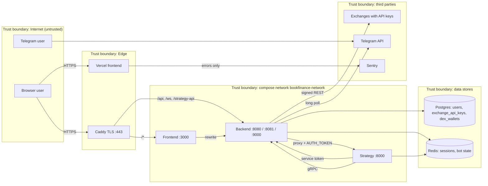

# 13 — Threat Model (DFD + STRIDE)

DFD ตาม `docs/diagrams/06-c4-container.md` แบ่ง trust boundary 4 ชั้น: Internet, edge (Caddy / Vercel), compose network
(frontend, backend, strategy), data stores; และ third-party ภายนอก. Mitigation และ gap ทุกข้ออ้าง file จริง

Sources: `docker-compose.prod.yml`, `Caddyfile`, `frontend/next.config.js`, `backend/cmd/main.go`, `backend/internal/adapter/http/*.go`, `strategy/infrastructure/api/app.py`, `frontend/src/lib/sentry.ts`, `backend/internal/domain/service/telegram_bot_service.go`.

## STRIDE per element

| Element | S | T | R | I | D | E | Existing mitigations (code) | Gaps |
|---|---|---|---|---|---|---|---|---|
| Browser → Caddy | ✓ | ✓ |  | ✓ |  |  | TLS 1.2/1.3, HSTS, `X-Frame-Options DENY`, `nosniff`, CSP (`Caddyfile`); Caddy overwrites `X-Real-IP` | CSP allows `'unsafe-inline' 'unsafe-eval'`; `Caddyfile` still `your-domain.com` |
| Frontend (token storage) | ✓ |  |  | ✓ |  | ✓ | Bearer token only from header for HTTP (`extractBearerToken`); 2-min `/api/auth/me` revalidation | Token in `localStorage` (no httpOnly) → XSS can steal it; no `middleware.ts`, dashboard guard is client-side |
| Backend router / auth | ✓ |  | ✓ |  | ✓ | ✓ | Access matrix fail-closed + CI test (`route_access.go`, `routes_access_test.go`); bcrypt; lockout per IP and per email+IP; `TRUSTED_PROXIES`; global 1000 req/min/IP; `BodyLimitMiddleware` 1 MB; audit log middleware → `audit_logs` | Lockout state in process memory (UPGRADE-PLAN P1); unknown-email login skips bcrypt (timing); trader can read operator balances/orders (`userReadAdmin`) |
| WebSocket :8081 | ✓ |  |  | ✓ | ✓ |  | Token required, `CheckOrigin` rejects empty Origin (`broadcaster.go`); `WS_MAX_CLIENTS` default 100 (`config.go`) | Token passed as `?token=` query → may be written to Caddy JSON access log |
| Strategy proxy | ✓ | ✓ |  | ✓ |  | ✓ | Section allow-list, dot/encoded segment reject, strips caller `Authorization`/`Cookie`/`X-Forwarded-*`, writes admin-only, 25 s timeout (`strategy_proxy.go`, `strategy_proxy_test.go`) | New upstream section must be added by hand (UPGRADE-PLAN P2) |
| Strategy API :8000 | ✓ | ✓ |  |  | ✓ | ✓ | `@auth_required` with `hmac.compare_digest`; fail closed in production without `AUTH_TOKEN` (`require_auth`); port bound to `127.0.0.1` | Single shared `AUTH_TOKEN` for both directions (backend→strategy and strategy→backend service routes) |
| Service token on backend | ✓ |  | ✓ |  |  | ✓ | Accepted only on `Service: true` routes, constant-time compare (`isServiceToken`) | Service calls carry no user ID → audit rows have no actor |
| gRPC :9000 | ✓ | ✓ |  |  |  | ✓ | Bound to `127.0.0.1` in compose | gRPC interceptors only log duration (`unaryInterceptor`, `streamInterceptor` in `grpc_server.go`), no auth, no TLS; any process on the compose network can call `ExecuteOrder` / `StartBot` |
| Telegram bot | ✓ |  |  |  |  | ✓ | `telegram_users.is_authorized` check per message | `/startbot` `/stopbot` bypass HTTP admin role; no `AuthorizeUser` call site → process to grant access is undocumented |
| Postgres | | ✓ |  | ✓ |  |  | Exchange keys AES-256-GCM with key from `ENCRYPTION_KEY` (`api_keys.go`); port bound to 127.0.0.1 in dev; prod not published | **DEX wallet private keys encrypted with a constant key in source** (`wallet_service.go getEncryptionKey`); `DATABASE_SSLMODE=disable` (same host only) |
| Redis | | ✓ |  | ✓ | ✓ |  | `--requirepass`; not published in prod | `allkeys-lru` may evict sessions / bot state |
| Exchanges | ✓ | ✓ | ✓ |  |  |  | Client order IDs + reconcile (`order_reconcile.go`), mainnet default off for strategy bots (`test_mainnet_default.py`), futures mainnet refused | Go `/api/trade/order` has no risk check of its own; relies on the Python `check_order_allowed` |
| Sentry | |  |  | ✓ |  |  | `scrubEvent` drops request, user, breadcrumbs, extra, frame vars, URL queries (`sentry.ts`, `sentry.test.ts`) | Backend and strategy have no Sentry |
| CI / supply chain | | ✓ |  |  |  | ✓ | Shared `security.yml` (gitleaks, Semgrep, OSV, Trivy); actions SHA-pinned; `uv.lock` + `--require-hashes` | No branch protection on `main` (`gh api .../branches/main/protection` → 404) |

Sources: ไฟล์ในคอลัมน์ mitigations / gaps, `docs/UPGRADE-PLAN.md` (P1/P2), `backend/internal/adapter/grpcserver/grpc_server.go`.

## Reused

- Central flow pack layer 6: `bookchaowalit/architecture-docs` → `docs/architecture/flows/booktrading-ui/06-authz-decision.md` และ `docs/architecture/ATTACK-PATH-DIAGRAMS.md` (ไม่ได้อ่านไฟล์หลังนี้). ข้อสรุปของ layer 6 ที่ว่า "most trading routes never check the token" **ไม่จริงแล้ว** ที่ 425b989.

## Open questions

- gRPC server ไม่มี auth (interceptor แค่ log) — ยืนยันว่าตั้งใจ trust compose network ทั้งหมดหรือไม่.
- มี DEX wallet ที่มีเงินจริงใน `dex_wallets` หรือไม่ (`DEX_ENABLED` default `false`)? ถ้ามี ควรย้าย key ไป `ENCRYPTION_KEY` / KMS ก่อน.
- Caddy JSON log เก็บไว้ที่ไหนและนานเท่าไร (เกี่ยวกับ WS token ใน query).
