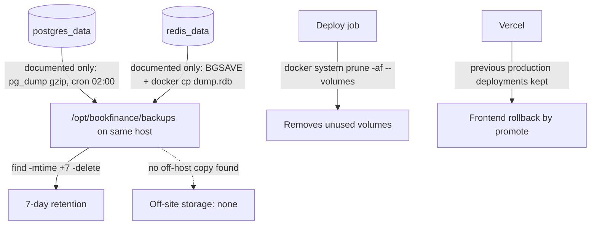

# 14 — Backup and Disaster Recovery

## ข้อมูลที่มีและอยู่ที่ไหน

| Data | Store / location | ความสำคัญ | Source |
|---|---|---|---|
| Users, orders, `real_trades`, `trade_journal`, finance, DEX wallets, encrypted exchange keys, audit | Postgres volume `postgres_data` บน compose host | สูง: audit ของเงินจริง | `docker-compose.prod.yml`, `backend/migrations/` |
| Sessions, market data channel, `real_grid:{symbol}:state` | Redis volume `redis_data` (AOF on) | กลาง: session สร้างใหม่ได้, grid state กู้จาก exchange ได้บางส่วน | `docker-compose.prod.yml`, `strategy/app/real_grid_bot.py` |
| TLS certs | `caddy_data`, `caddy_config` | ต่ำ: ออกใหม่ได้ | `docker-compose.prod.yml` |
| Strategy local files (SQLite `DurablePaperJournal`, snapshot reports) | ใน container filesystem — **prod compose ไม่มี volume ให้ strategy**; dev mount `./data:/app/data` | กลาง: evidence ของ paper lane | `docker-compose.prod.yml`, `docker-compose.yml`, `strategy/app/alpha/durable_journal.py`, `PRODUCTION.md` (snapshots in `strategy/reports/grid-bot/`) |
| Balances / fills จริง | ที่ exchange (Binance TH, Bitkub) — source of truth | — | `backend/internal/adapter/exchange/` |
| Frontend | Vercel deployment (stateless) | ต่ำ | `specs/001-shared-ci-sentry-deps/spec.md` §5 |
| Evidence ของ operator | `docs/EVIDENCE_LOG.md` ใน Git | กลาง | `docs/EVIDENCE_LOG.md` |

## Backup / restore ที่มีจริง

Sources: `PRODUCTION.md` (Step 6 backup script และ crontab — เป็นตัวอย่างใน doc ไม่ได้เป็นไฟล์ใน repo), `.github/workflows/ci-cd.yml` (`deploy` script), `docker-compose.prod.yml`, `vercel ls booktrading-frontend --prod` (4 production deployments, 2026-11-03).

ความจริง ณ 2026-11-03:
- ไม่มี backup script, workflow หรือ cron ใน repo — มีแค่ตัวอย่างใน `PRODUCTION.md`. README บอก "Automated Backups — daily database backups" แต่ไม่พบ implementation.
- Backup ตามตัวอย่างอยู่บน host เดียวกับ database (ไม่ off-site, ไม่เข้ารหัส).
- ไม่มี restore runbook หรือ restore drill ใน repo (`RUNBOOK.md` มีแค่ "Redeploy previous container image / previous git tag" แต่ไม่มี image registry และไม่มี tag).
- Migration 013, 014, 018, 019, 020 ไม่มี `.down.sql` จึง rollback schema ไม่ได้ทุกขั้น.
- Redis เคยไม่ restart หลัง host reboot จน backend error ~24h (`docs/EVIDENCE_LOG.md` 2026-07-23) — แก้แล้วด้วย `restart: unless-stopped` ใน `docker-compose.yml`.

## RTO / RPO

| | Value |
|---|---|
| RTO | not defined |
| RPO | not defined (ถ้าทำตาม `PRODUCTION.md` cron จะได้ ~24h สำหรับ Postgres, แต่ไม่มีหลักฐานว่าตั้งไว้) |

## Open questions

- Compose host จริงมี cron backup ตาม `PRODUCTION.md` หรือไม่ และสำเนาอยู่ที่ไหน?
- ต้องการเพิ่ม repo นี้เข้า nightly encrypted backup to R2 แบบ service อื่นของ owner หรือไม่ (ไม่พบ config ใน repo นี้)?
- Strategy local state (SQLite journal, reports) ใน prod ควรมี volume หรือไม่ — ตอนนี้หายเมื่อ container ถูกสร้างใหม่.
- RTO / RPO เป้าหมายของ owner.
