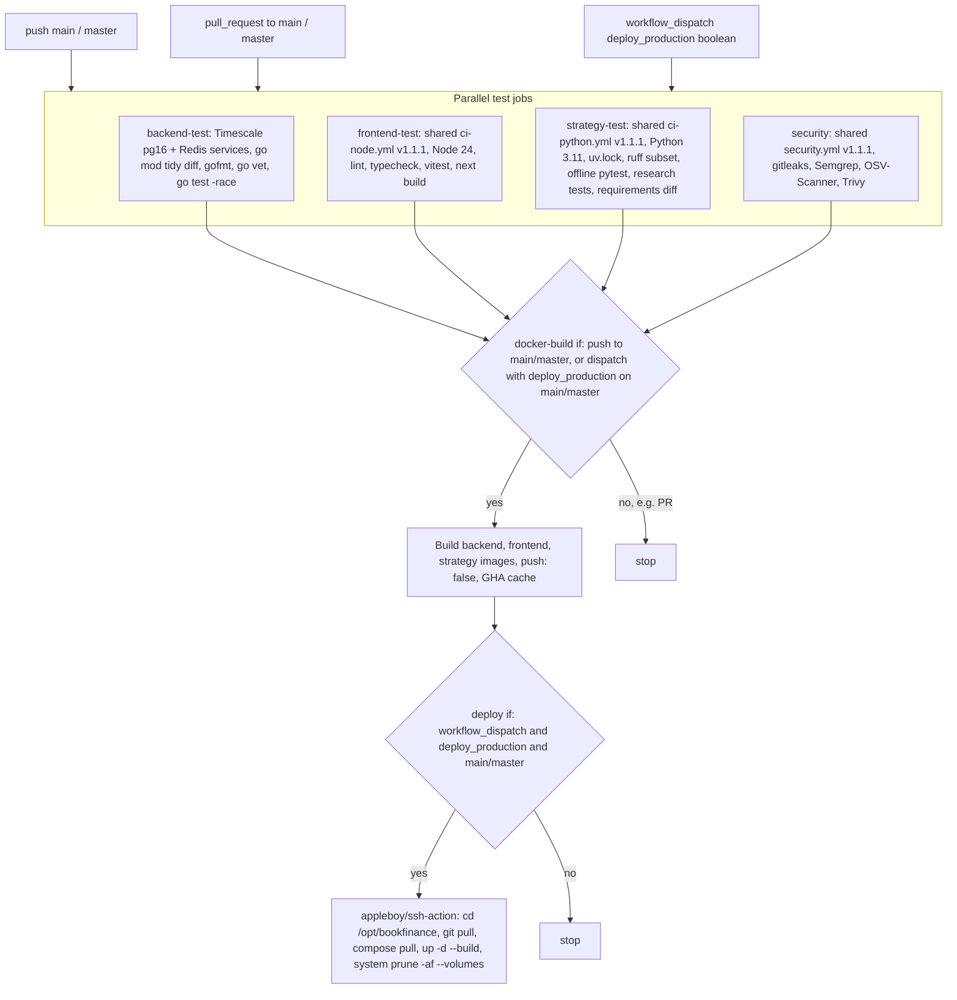

# 15 — CI/CD Pipeline

Workflow เดียว: `.github/workflows/ci-cd.yml` ("CI/CD Pipeline"), `permissions: contents: read`

Sources: `.github/workflows/ci-cd.yml`, `specs/001-shared-ci-sentry-deps/spec.md` §2.

ข้อสังเกต:
- `docker-build` สร้าง image แล้วทิ้ง (`push: false`) — deploy บน host build ใหม่ด้วย `--build` จาก `git pull` อีกรอบ.
- Secrets ที่ deploy ใช้: `PRODUCTION_HOST`, `PRODUCTION_USER`, `SSH_PRIVATE_KEY` (ชื่อจาก workflow เท่านั้น).
- Frontend live (Vercel) **ไม่อยู่ใน pipeline นี้** — deploy ด้วย `vercel` CLI จากเครื่อง owner (ดู [16-deployment](16-deployment.md), [18-git-release-workflow](18-git-release-workflow.md)).
- Strategy test exclude `tests/test_command_center_contract.py` (live API) และ Playwright e2e ไม่ถูกเรียก.
- ผล 90 วัน (`gh run list`, ตั้งแต่ 2026-08-05): 22 run ทั้งหมดเป็น `push` บน main — 17 success, 5 failure; ไม่มี `workflow_dispatch` run.

## Open questions

- Secrets `PRODUCTION_HOST` ฯลฯ ยังตั้งอยู่ใน repo settings หรือไม่ (ไม่ได้ตรวจ — `gh secret list` ต้องใช้สิทธิ์ admin).
