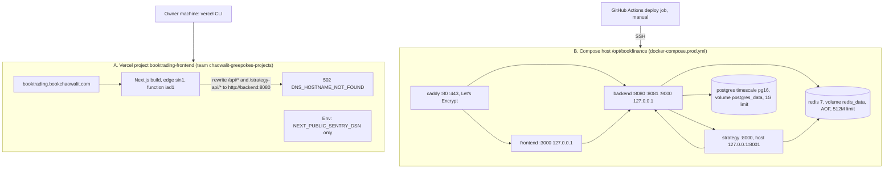

# 16 — Deployment

มี 2 deployment target ที่แยกกันจริง: (A) Vercel frontend ที่เป็น live domain และ (B) full stack บน self-hosted compose host
ตาม `docker-compose.prod.yml` + `Caddyfile` (domain ยังเป็น placeholder `your-domain.com`)

Sources: `docker-compose.prod.yml` (services, ports, memory limits, volumes, `ENVIRONMENT=production`), `Caddyfile`, `frontend/next.config.js`, `frontend/Dockerfile`, `.github/workflows/ci-cd.yml` (`deploy`), `specs/001-shared-ci-sentry-deps/spec.md` §5; live checks 2026-11-03: `curl -sI https://booktrading.bookchaowalit.com` (`server: Vercel`, 307 → `/th`), `curl https://booktrading.bookchaowalit.com/api/health` (502 `DNS_HOSTNAME_NOT_FOUND`), `vercel env ls --project booktrading-frontend`, `vercel ls booktrading-frontend --prod`.

## Environments

| Env | Where | Config |
|---|---|---|
| Local dev | `docker-compose.yml` (containers `trading-bot-*`, frontend :3001, ports bound 127.0.0.1) หรือ `docker-compose.dev.yml` | `ENVIRONMENT` default `development`, registration open |
| Production (full stack) | compose host ไม่ระบุใน repo | `ENVIRONMENT=production` ใน backend + strategy, registration closed |
| Production (frontend only) | Vercel `booktrading-frontend` | CLI deploy; 4 production deployments: 2026-08-12, 2026-10-23, 2026-10-24 ×2 |

## Reused

- `PRODUCTION.md` (server setup, firewall, env) — reused เป็น runbook การติดตั้ง; ไม่คัดลอกมา.
- Central flow pack README ("Local surfaces"): `bookchaowalit/architecture-docs` → `docs/architecture/flows/booktrading-ui/README.md`.

## Open questions

- Compose host production ปัจจุบันคืออะไร / ยังมีอยู่ไหม? ถ้าไม่มี ควรระบุใน README ว่า live site เป็น frontend demo ที่ไม่มี backend.
- ต้องการให้ Vercel frontend ชี้ไป backend จริง (ตั้ง `BACKEND_URL`) หรือให้เป็น static showcase?
- Vercel project ยังไม่ผูก Git (SPEC-001/002 §5) — ต้องการ relink ให้ push = deploy หรือไม่?
