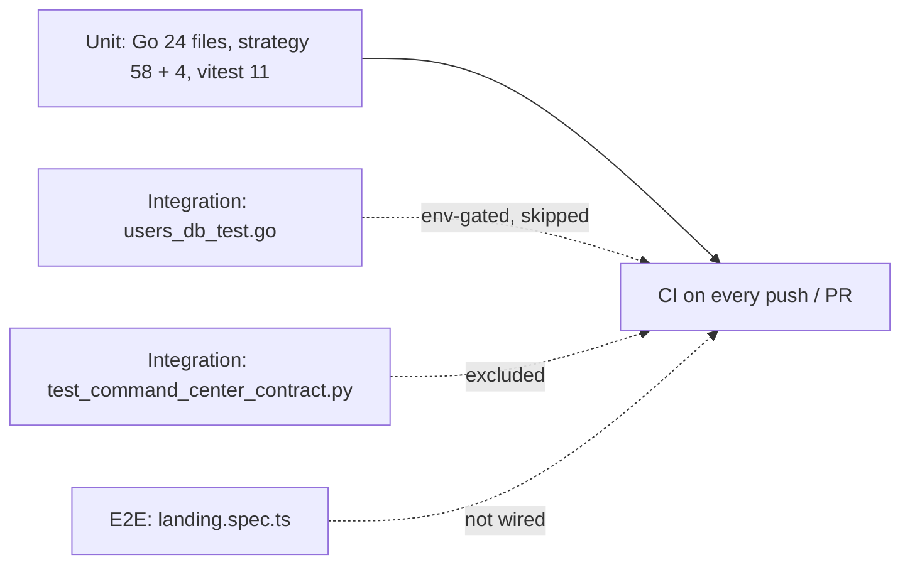

# 17 — Test Coverage Matrix

นับจากไฟล์ test จริงใน Git (`git ls-files`): Go `*_test.go` 24 ไฟล์, strategy `tests/test_*.py` 58 ไฟล์ + research tests 4 ไฟล์,
frontend vitest 11 ไฟล์ + Playwright 1 ไฟล์

นิยามระดับ:
- **unit** — in-process, dependency ภายนอกเป็น fake (`httptest`, fake store, pytest fixtures, socket ถูกปิดใน CI)
- **integration** — ใช้ dependency จริง (Postgres, running API) หรือ router จริงทั้งชุด
- **e2e** — browser กับ app ที่รันอยู่

| Feature | Unit | Integration | E2E | CI runs it? |
|---|---|---|---|---|
| Login, lockout, client IP | `login_lockout_test.go` | `auth_boundary_test.go` (real router) | — | yes (backend-test) |
| Registration gate | `registration_test.go`, `auth-config.test.ts`, `LoginModal.test.tsx` | `registration_test.go` `/api/auth/config` through real router | — | yes |
| User persistence | `auth_persistence_test.go` (fake store) | `users_db_test.go` (needs `BOOKTRADING_TEST_DATABASE_URL`) | — | unit yes; DB test **skipped** in CI |
| Access matrix | `routes_access_test.go` | same file drives real gate over every pattern × 6 methods × 5 callers | — | yes |
| Strategy proxy | `strategy_proxy_test.go`, `strategy-services-auth.test.ts` | — | — | yes |
| Finance per-user scoping | `finance_account_auth_test.go`, `finance_transaction_auth_test.go`, `finance_resource_auth_test.go`, `finance_percent_test.go` | — | — | yes |
| DCA auth + order grid | `dca_auth_test.go`, `test_dca_order_grid.py` | — | — | yes |
| Go bot / grid / signal | `bot_safety_test.go`, `grid_position_test.go`, `grid_reconcile_test.go`, `signal_trade_test.go`, `service_test.go` | — | — | yes |
| Exchange reconcile (Binance, Bitkub) | `order_reconcile_test.go`, `bitkub_reconcile_test.go`, `bitkub/orders_v3_test.go` | — | — | yes |
| Paper engine fills | `paper_engine_fill_test.go`, `test_paper_execution.py`, `test_paper_state.py` | — | — | yes |
| DEX / impermanent loss | `dex_test.go`, `impermanent_loss_test.go` | — | — | yes |
| Config validation | `config_test.go`, `test_config.py` | — | — | yes |
| Kill switch / risk | `test_kill_switch.py`, `test_real_grid_halt.py`, `test_safety_filters.py`, `test_safety_reset_auth.py`, `test_risk_gate.py` | — | — | yes |
| Real grid multi-symbol, sync | `test_real_grid_multi_symbol.py`, `test_grid_sync.py`, `test_grid_safety.py` | — | — | yes |
| Mainnet defaults, futures safety | `test_mainnet_default.py`, `test_futures_safety.py` | — | — | yes |
| Strategy API auth | `test_mutating_routes_auth.py`, `test_route_access_matrix.py`, `test_require_auth_production.py`, `test_backend_auth.py` | — | — | yes |
| Command center contract | `frontend/src/test/contract.test.ts` | `test_command_center_contract.py` (marker `integration`) | — | frontend yes; Python **excluded** (`--ignore` + `addopts -m 'not integration'`) |
| Monitor decision tree | `test_monitor_decision.py` | — | — | yes |
| Backtests | `test_grid_backtester.py`, `test_futures_backtest.py`, `research/tests/futures_backtest_test.py`, `walk_forward_test.py` | — | — | yes |
| Polymarket | `test_polymarket_dates.py` | — | — | yes |
| Market intel / on-chain / EVM / Solana | `test_degen_discovery.py`, `test_evm_*.py` (7), `test_onchain_*.py` (4), `test_solana_*.py` (3), `test_cluster_sell_adapter.py`, `test_wallet_intelligence.py` | — | — | yes |
| Alpha / world / portfolio lanes | `test_alpha_*.py` (5), `test_world_*.py` (6), `test_portfolio_*.py` (5), `test_trade_intent.py`, `research/tests/data_test.py`, `lake_signal_test.py` | — | — | yes |
| Indicators | `test_indicators.py` | — | — | yes |
| Frontend API client, 403 UX | `api.test.ts`, `forbidden.test.ts`, `auth-role.test.ts` | — | — | yes |
| Frontend errors / health | `ErrorBoundary.test.tsx`, `SystemHealthCheck.test.tsx`, `sentry.test.ts` | — | — | yes |
| Landing page | `landing-copy.test.ts` | — | `frontend/e2e/landing.spec.ts` (Playwright) | unit yes; e2e **not in CI** |
| Dashboard pages (32+), WebSocket client, DEX handlers, gRPC server, Telegram bot, migrations | — | — | — | **gap** |

Sources: test files ตามตาราง, `.github/workflows/ci-cd.yml` (`test-command`), `strategy/pyproject.toml` (`addopts = "-m 'not integration'"`), `frontend/playwright.config.ts`, `docs/UPGRADE-PLAN.md` (P1 DB-backed users test, P2 "Go adapter/exchange, adapter/repository, adapter/grpcserver have no tests" — exchange มี test แล้ว, repository และ grpcserver ยังไม่มี).

## Open questions

- ไม่มีตัวเลข coverage % (`go test -coverprofile` สร้างไฟล์แต่ไม่ upload / ไม่ gate; shared CI coverage gate opt-in ไม่ได้เปิด).
- ต้องการ e2e สำหรับ core 5 dashboard pages หรือไม่ (ต้องมี backend fixture).
