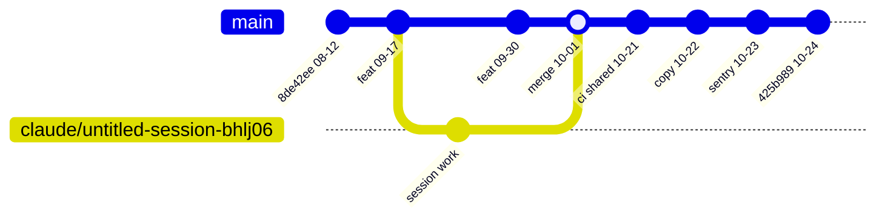
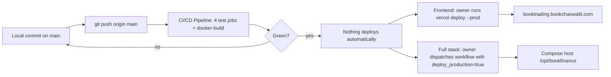

# 18 — Git and Release Workflow

ข้อเท็จจริงจาก Git / GitHub (2026-11-03):
- Remote: `bookchaowalit-ai/finance-booktrading`; branch บน remote: `main` และ `claude/untitled-session-bhlj06`.
- PR ทั้งหมดในประวัติ: 1 (#1 "chore: clean booktrading runbook and credentials", merged 2026-07-26).
- 90 วันล่าสุด: 62 commit บน main, merge commit 1 ตัว (`Merge branch 'claude/untitled-session-bhlj06'`, 2026-10-01) — ที่เหลือ push ตรงเข้า main.
- `main` ไม่มี branch protection (`gh api repos/bookchaowalit-ai/finance-booktrading/branches/main/protection` → 404) และไม่มี ruleset (`/rulesets` → `[]`).
- ไม่มี git tag / GitHub release.

Sources: `git log origin/main`, `git branch -r`, `gh pr list --state all`, `gh api .../branches/main/protection`, `gh api .../rulesets`, `.github/workflows/ci-cd.yml`, `specs/001-shared-ci-sentry-deps/spec.md` §5, `specs/002-truthful-landing-copy/spec.md` §5, `vercel ls booktrading-frontend --prod`.

หมายเหตุ: gitGraph ข้างบนย่อ commit ให้เห็นรูปแบบ (main-only + 1 merge) ไม่ได้แสดงครบ 62 commit; commit ที่อยู่บน branch `claude/untitled-session-bhlj06` แสดงเป็น "session work" หนึ่งจุด.

## Open questions

- Branch `claude/untitled-session-bhlj06` ถูก merge แล้ว — ลบได้หรือไม่?
- ต้องการเปิด branch protection (required checks) บน main หรือคง main-only push ตามนโยบาย solo?
