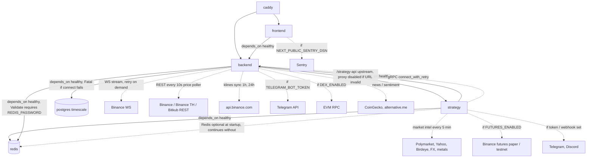

# 19 — Service Dependency Map (runtime)

เส้นทึบ = จำเป็นตอน start (compose `depends_on: condition: service_healthy` หรือ code fatal), เส้นประ = optional / degrade ได้

Sources: `docker-compose.prod.yml` (`depends_on`, healthchecks), `backend/cmd/main.go` (`cfg.Validate`, `logger.Fatal` on DB, strategy proxy creation, Binance stream connect, price poller, `historicalService.StartSync`, Telegram, DEX init), `backend/internal/config/config.go` (`Validate`), `strategy/infrastructure/api/app.py` (`lifespan`: `connect_with_retry`, Redis non-fatal, market intel scan, futures opt-in), `strategy/app/webhook_notifier.py`, `frontend/src/lib/sentry.ts`.

## Healthchecks ที่ compose ใช้

| Service | Check | Source |
|---|---|---|
| postgres | `pg_isready` | `docker-compose.prod.yml` |
| redis | `redis-cli -a $REDIS_PASSWORD ping` | `docker-compose.prod.yml` |
| backend | `wget --spider http://localhost:8080/api/health` (handler คืน `{"status":"healthy"}` คงที่ ไม่เช็ค DB/Redis) | `docker-compose.prod.yml`, `backend/internal/adapter/http/handler.go` (`HealthCheck`) |
| strategy | `curl -f http://localhost:8000/api/health` | `docker-compose.prod.yml`, `strategy/infrastructure/api/app.py` |
| frontend, caddy | none | `docker-compose.prod.yml` |

## Open questions

- Backend `/api/health` ไม่ตรวจ dependency — ต้องการ readiness check ที่เช็ค Postgres/Redis หรือไม่?
