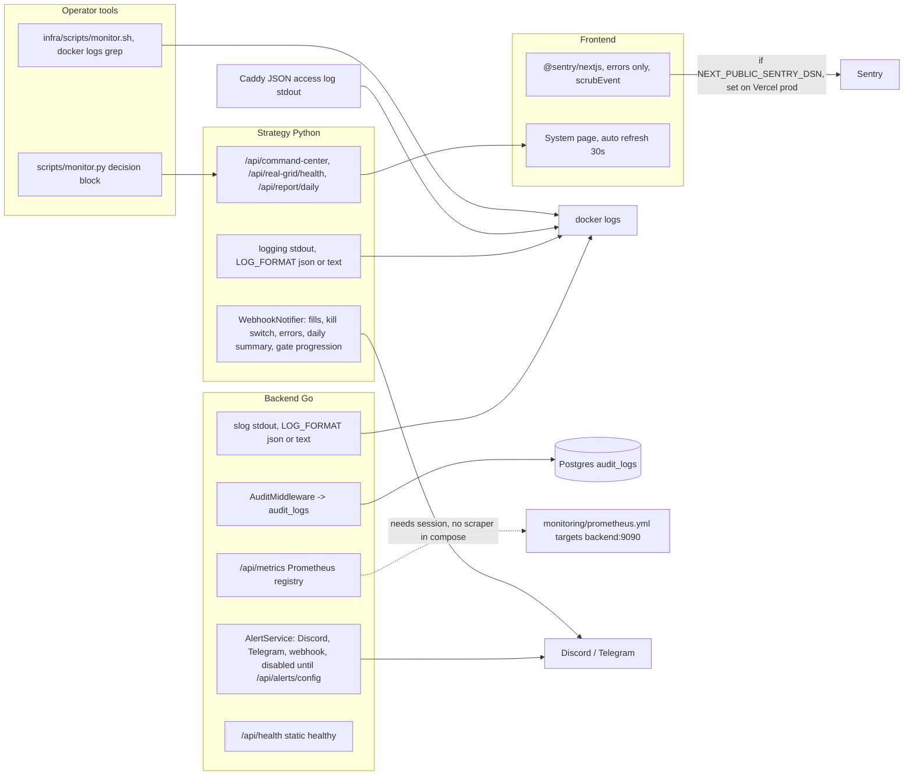

# 20 — Observability

Signal ที่มี instrumentation จริงใน code และสิ่งที่ "มีแต่ไม่ได้ต่อ"

Sources: `frontend/src/lib/sentry.ts`, `frontend/src/instrumentation-client.ts`, `frontend/src/instrumentation.ts`, `frontend/src/app/[lang]/dashboard/system/page.tsx`, `backend/internal/logger/` (`LOG_LEVEL`, `LOG_FORMAT`), `backend/internal/adapter/http/audit_middleware.go`, `backend/internal/domain/service/audit_service.go`, `backend/internal/domain/service/metrics.go`, `backend/internal/adapter/http/feature_handler.go` (`/api/metrics`, metric calls), `backend/internal/domain/service/alert_service.go`, `backend/cmd/main.go` (`NewAlertService(nil)`, EventBus subscriptions), `strategy/app/main.py` (logging), `strategy/app/webhook_notifier.py`, `strategy/app/real_grid_bot.py` (`send_kill_switch_alert`, `send_fill_alert`), `strategy/scripts/monitor.py`, `infra/scripts/monitor.sh`, `monitoring/prometheus.yml`, `Caddyfile` (`log { output stdout format json }`), `vercel env ls --project booktrading-frontend`.

## What is watched (และใครเห็น)

| Signal | ใครเห็น / ไปไหน | Status |
|---|---|---|
| Frontend errors | Sentry (DSN ตั้งบน Vercel Production) | live |
| Kill switch / fills / errors ของ real grid | Telegram / Discord ถ้าตั้ง `TELEGRAM_BOT_TOKEN`+`TELEGRAM_CHAT_ID` หรือ `DISCORD_WEBHOOK_URL` บน strategy | ขึ้นกับ env host (ไม่ทราบ) |
| Backend EventBus alerts (bot start/stop, trade, risk, system error, paper trade) | AlertService — config เริ่มต้น `Enabled: false` | off until configured via API |
| Prometheus metrics | `/api/metrics` (userReadAdmin) | defined แต่ไม่มี scraper; ส่วนใหญ่ไม่ถูกบันทึก (ดูด้านล่าง) |
| Audit trail | ตาราง `audit_logs` (admin อ่านผ่าน `/api/audit/logs`) | live เมื่อ backend รัน |
| Uptime ภายนอก | — | **ไม่มี**: `platform-uptime-worker` (local clone 2026-11-03) ไม่มี entry ของ booktrading; repo ไม่มี deploy-smoke / heartbeat |
| Backend / strategy exceptions | stdout logs เท่านั้น | ไม่มี Sentry ฝั่ง Go / Python |

## Gaps ที่เห็นจาก code

- `MetricsService` มี method `ObserveHTTPRequest`, `RecordTrade`, `ObserveExchangeAPI`, `ObserveDBQuery`, `RecordAlert` แต่ call site นอก `metrics.go` มีแค่ `RecordPaperTrade`, `UpdateActiveBots`, `RecordRiskCheck` (ใน `feature_handler.go`) — ดังนั้น `trades_failed_total` ที่ `docs/measurement/KPI-PLAN.md` อ้างเป็น evidence ของ KPI-G-02 **ไม่ถูกเพิ่มค่าเลย**.
- `monitoring/prometheus.yml` scrape `backend:9090`, `postgres-exporter`, `redis-exporter`, `caddy:2019`, `node-exporter` — ไม่มี service เหล่านี้ใน compose และ backend ไม่ได้ listen 9090.
- `infra/scripts/monitor.sh` grep container `trading-bot-strategy` (ชื่อใน dev compose) — ใช้กับ prod (`bookfinance-strategy`) ไม่ได้.

## Open questions

- ต้องการเพิ่ม `booktrading.bookchaowalit.com` เข้า uptime worker หรือไม่ (ตอนนี้ `/api/health` บน Vercel ตอบ 502 อยู่แล้ว จะ alert ทันที).
- Telegram / Discord env ตั้งบน compose host จริงหรือไม่?
