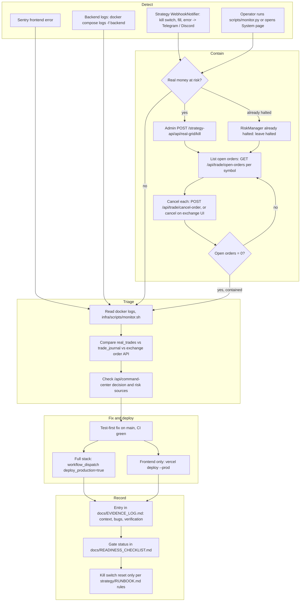

# 21 — Incident Response

ไม่มี incident runbook เฉพาะใน repo; flow ข้างล่างประกอบจาก alert channel และเครื่องมือที่มีจริง
และจาก incident ที่เคยบันทึกใน `docs/EVIDENCE_LOG.md` (2026-07-23: `real_trades` บันทึกผิด + Redis ไม่ restart หลัง host reboot)

Sources: `strategy/app/webhook_notifier.py` (`send_kill_switch_alert`, `send_fill_alert`, `send_error_alert`), `strategy/app/real_grid_bot.py`, `frontend/src/lib/sentry.ts`, `strategy/scripts/monitor.py`, `infra/scripts/monitor.sh`, `PRODUCTION.md` (Troubleshooting), `strategy/RUNBOOK.md` ("When NOT to Reset Kill Switch"), `docs/EVIDENCE_LOG.md` (2026-07-23 entry: cross-check กับ Binance TH `GET /api/v1/order`, LEFT JOIN `real_trades` ↔ `trade_journal`), `docs/READINESS_CHECKLIST.md`, `.github/workflows/ci-cd.yml`, `RUNBOOK.md` (Owner: "Solo operator, no multi-person on-call").

Kill / halt ไม่ cancel order: `RealGridBot.disable()` แค่ตั้ง `_enabled = False` และ `RiskManager._halt()` เรียก `disable()` (`strategy/app/real_grid_bot.py`, `strategy/app/risk_manager.py`, `/api/real-grid/kill` ใน `app.py`) — limit order ที่ค้างที่ exchange ยัง fill ต่อได้ จึงต้องตรวจและ cancel open orders ก่อนถือว่า contained. Endpoint ที่ใช้ได้: `/api/trade/open-orders`, `/api/trade/cancel-order` (service route; admin session หรือ service token, `route_access.go`) หรือ `infra/scripts/monitor.sh` ที่นับ open orders ของ 5 symbol.

## Roles

| Role | Who | Source |
|---|---|---|
| On-call, incident commander, fixer | owner คนเดียว | `RUNBOOK.md` |
| Approver for kill-switch reset | owner, ตาม gate checklist ("Do not self-approve") | `docs/READINESS_CHECKLIST.md` |

## Open questions

- Severity levels, response-time target และ postmortem template ยังไม่กำหนด — ใช้ EVIDENCE_LOG แทนอยู่ ต้องการแยก postmortem หรือไม่?
- Alert ไม่มีจาก backend (AlertService ปิด default) และไม่มี uptime monitor — host down จะไม่มีใครรู้จนกว่า operator เปิดดูเอง.
- Rollback: ไม่มี image tag; full stack rollback ต้อง `git checkout` commit เก่าบน host แล้ว `up -d --build` (ไม่มีขั้นตอนเขียนไว้).
