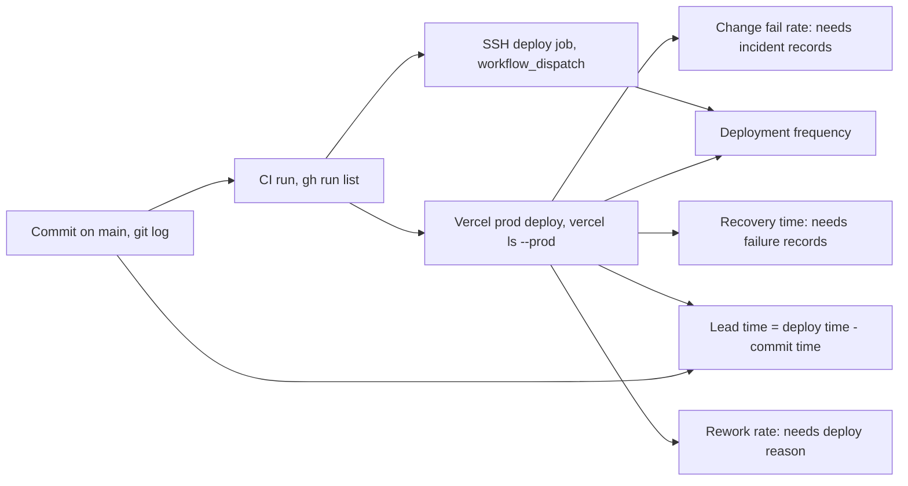

# 22 — DORA Metrics

Window: 90 วันล่าสุด **2026-08-05 → 2026-11-03**. "Production deployment" มี 2 ช่องทาง:
(1) Vercel CLI deploy ของ frontend (`booktrading-frontend`) และ (2) job `deploy` ใน `ci-cd.yml` สำหรับ full stack.
ไม่มี DORA dashboard หรือ tooling ใน repo — ตัวเลขข้างล่างคำนวณมือจากคำสั่งที่แสดง



Sources: `.github/workflows/ci-cd.yml`, `specs/001-shared-ci-sentry-deps/spec.md` §5, คำสั่งด้านล่าง.

## 1. Deployment frequency — **computed**

```bash
vercel ls booktrading-frontend --prod          # 4 Ready production deployments
vercel inspect <url>                           # created: 2026-08-12 17:17, 2026-10-23 11:50, 2026-10-24 12:21, 2026-10-24 16:58 (+07)
gh run list -R bookchaowalit-ai/finance-booktrading --limit 200 --json event,createdAt \
  | jq '[.[] | select(.createdAt >= "2026-08-05" and .event == "workflow_dispatch")] | length'   # 0
```

| Channel | Deploys in 90 days | Rate |
|---|---|---|
| Vercel frontend | 4 (3 ในวันที่ 2026-10-23/24) | ≈ 0.31 / week, bursty |
| Full stack SSH deploy | 0 | none |

## 2. Lead time for changes — **computed (approximation)**

Vercel CLI deploy ไม่มี commit SHA จึงสมมติว่า deploy มี `origin/main` ณ เวลานั้น; lead time = deploy ถัดไปหลัง commit − commit time
สำหรับ commit ที่แตะ `frontend/`:

```bash
git log origin/main --since=2026-08-05 --format='%H %ct %s' -- frontend/
# then, per commit: first Vercel production deploy at or after the commit time
```

| ผล | ค่า |
|---|---|
| Commits ที่แตะ `frontend/` | 18 |
| Median lead time (ทั้ง 18) | ≈ 283 h (11.8 วัน) |
| Median ไม่นับ `8de42ee` (.gitignore เท่านั้น, 1722 h) | 34.6 h |
| Fastest | `79d5c6e` next 15.5.28 security fix → deploy ใน ≈ 0.2 h |
| Slowest runtime change | `41a38d1` (2026-09-09) → 2026-10-23 ≈ 1048 h |

Full stack (backend / strategy): **cannot compute** — ไม่มี deploy ใน window และไม่รู้ว่า compose host รัน commit ไหน.

## 3. Change fail rate — **cannot compute**

ไม่มี record ว่า deploy ไหนทำให้ production เสีย (ไม่มี incident log หลัง 2026-08-11 ใน `docs/EVIDENCE_LOG.md`, ไม่มี uptime monitor, Vercel ทั้ง 4 deploy สถานะ Ready).
Proxy ที่วัดได้:

```bash
gh run list -R bookchaowalit-ai/finance-booktrading --limit 200 --json event,conclusion,createdAt \
  | jq '[.[] | select(.createdAt >= "2026-08-05")] | group_by(.conclusion) | map({(.[0].conclusion): length}) | add'
# {"failure":5,"success":17}  -> CI fail rate on main 5/22 = 23%
git log origin/main --since=2026-08-05 --format=%s | grep -ci '^revert'   # 1 of 62 commits
```

## 4. Failed deployment recovery time — **cannot compute**

ไม่มี failed deployment ที่บันทึกไว้. Proxy: เวลาที่ main CI แดงจนกลับเขียว (`gh run list` ข้างบน):

| Red run (UTC) | Next green (UTC) | Time to green |
|---|---|---|
| 2026-09-30 14:09 | 2026-10-01 02:52 | ≈ 12.7 h |
| 2026-10-11 14:05 (แดงต่อ 10-12 ×2, 10-15 06:41) | 2026-10-15 07:02 | ≈ 89 h |

## 5. Deployment rework rate — **cannot compute**

ต้องรู้ว่า deploy ไหนเป็น unplanned fix ของ production. ข้อสังเกต: 2026-10-24 มี 2 production deploy ห่างกัน 4.6 h โดยไม่มี commit ที่แตะ `frontend/` ระหว่างนั้น (commit เดียวคือ `425b989` docs) — อาจเป็น redeploy เพื่อแก้ env หรือ re-run; ไม่มีบันทึกเหตุผล.

## Open questions

- ต้องการให้ deploy มี SHA (Vercel Git link หรือ `vercel deploy --meta gitCommitSha=...`) เพื่อวัด lead time ได้จริงหรือไม่?
- นิยาม "production failure" สำหรับ product นี้คืออะไร (frontend error rate ใน Sentry? kill switch trigger? 502 บน live site ซึ่งเป็นอยู่ตอนนี้)?
- Deploy 2 ครั้งวันที่ 2026-10-24 ทำเพื่ออะไร?
